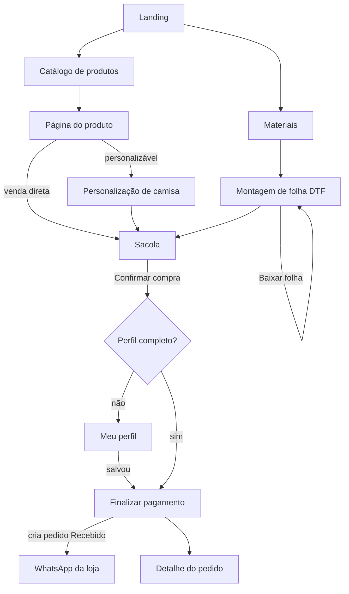
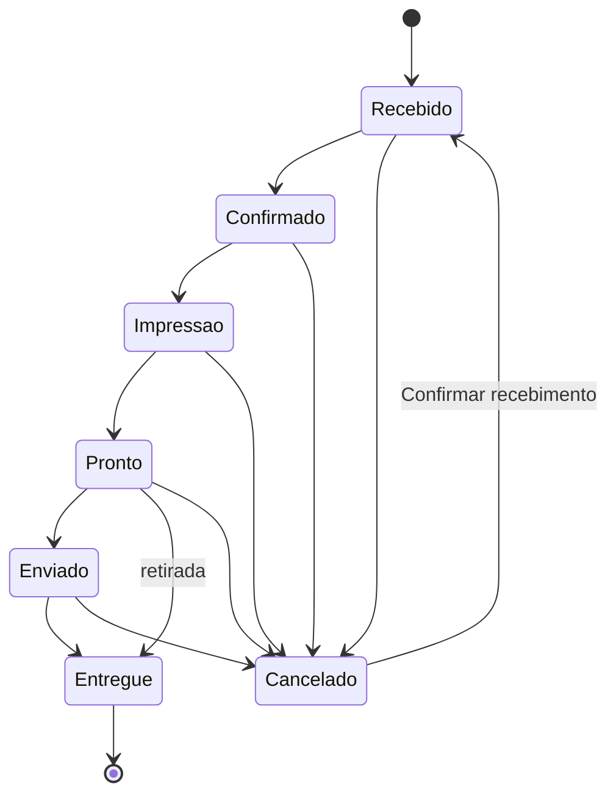

# Especificação Funcional: NorDTF Personalização

| Versão | Data | Descrição | Responsável | Aprovação |
|---|---|---|---|---|
| V0.1 | 04/10/2026 | Criação do documento a partir da análise do Figma e do código atual. Regras gerais, fases 0 a 12, decisões pendentes, erratas do protótipo e impacto no modelo de dados. | Rascunho: Claude. Revisão: Jeferson Augusto. | Pendente |
| V0.2 | 04/10/2026 | Decisões D04 (folha cobrada por m²), D05 (camisa pelo preço do produto), D25 (WhatsApp de teste) e D30 (stack Vue) aplicadas nas fases 0, 3, 8, 9, 10 e 12. | Rascunho: Claude. Decisões: Jeferson Augusto. | Pendente |
| V0.3 | 13/11/2026 | Alinhamento com a `PROPOSTA.md` do Julian (PR #1, na `main`) e com a landing (PR #2). Sem catálogo nem CRUD de estampas: a Fase 5 sai e o cliente usa só as próprias artes (D31). O cliente exporta a folha montada (D32, revoga D13). A landing ocupa `/` e o catálogo vai para `/produtos` (D33). Página pública de materiais (D34) e WhatsApp da loja acessível a todos (D35). Situação das fases 1 e 3 atualizada e pendências de código listadas na seção 8. | Rascunho: Claude. Decisões: Jeferson Augusto. | Pendente |
| V0.4 | 14/11/2026 | Fase 4 entregue (plano `produtos-admin`) e pendências P01 a P04 feitas. F4RN03 filtra tamanho por estoque, F4RN11 registra o destino de "Sair", F4RN12 é só leitura com preço (E27), RG07 registra o storage, a validação da Fase 4 ganha os textos que faltavam e a seção 14 traz o `Item` ligado à `ProdutoVariante` e a `ProdutoCor.posicao`. | Rascunho: Claude. Decisões: Jeferson Augusto. | Pendente |
| V0.5 | 15/11/2026 | Fase 6 entregue (plano `catalogo-loja`). Catálogo, página do produto e `/materiais` com as regras do que o Figma não desenha (canvas no `docs/figma.md`). Comportamento provisório de "Personalizar", "Adicionar à sacola", "Montar folha" e do envio de arte até as Fases 7, 8 e 9, e a escolha do cliente na URL. F6RN07 lê o número de `VITE_WHATSAPP_NUMERO`. Fases 7, 8 e 9 lembram de trocar o aviso provisório. Tabela de API da Fase 6 com o formato final. | Rascunho: Claude. Decisões: Jeferson Augusto. | Pendente |

Links do Figma versionados em [`docs/figma.md`](../../docs/figma.md). Capturas das telas em [`telas/`](telas/), com o ID do frame no nome do arquivo.

## Sumário

1. [Contexto geral](#1-contexto-geral)
2. [Objetivo do documento](#2-objetivo-do-documento)
3. [Visão geral da necessidade](#3-visão-geral-da-necessidade)
4. [Glossário](#4-glossário)
5. [Perfis de usuário](#5-perfis-de-usuário)
6. [Delimitação de escopo](#6-delimitação-de-escopo)
7. [Requisitos não funcionais](#7-requisitos-não-funcionais)
8. [Mapa de fases](#8-mapa-de-fases)
9. [Regras de negócio gerais](#9-regras-de-negócio-gerais)
10. [Fases](#10-fases)
11. [Fora do MVP](#11-fora-do-mvp)
12. [Decisões pendentes](#12-decisões-pendentes)
13. [Erratas do Figma](#13-erratas-do-figma)
14. [Impacto no modelo de dados](#14-impacto-no-modelo-de-dados)
15. [Aderência à disciplina](#15-aderência-à-disciplina)

---

## 1. Contexto geral

A NorDTF é uma loja de personalização com impressão DTF (Direct to Film). Pelo protótipo, ela vende três coisas:

- **Produtos personalizáveis**, como camisas oversized, em que o cliente aplica uma estampa na frente, nas costas ou nos dois lados.
- **Produtos de venda direta**, prontos, sem personalização.
- **Folhas de material DTF e DTF UV**, de 57 cm de largura, que o cliente monta com as próprias artes e recebe para aplicar.

A loja não tem catálogo de estampas. Toda estampa usada na camisa ou na folha é um arquivo enviado pelo cliente (D31).

Pagamento e entrega não acontecem no sistema. Ao finalizar, o cliente é levado ao WhatsApp da loja para combinar os dois. O sistema registra o pedido completo para a produção: produto, cor, tamanhos, estampas, medidas, cópias e arquivos.

O projeto é o trabalho final da disciplina QXD0279 (UFC Quixadá), no repositório criado pelo kit do professor, feito por Julian Cardoso e Jeferson Augusto. O backend fica em `backend/` (Express 5, Prisma 8, PostgreSQL, sessão por cookie) e o frontend em `frontend/` (Vue 3, D30). A `PROPOSTA.md`, aprovada pelo professor no PR #1, é o compromisso de escopo com a disciplina, e esta especificação segue o que ela promete (seção 15).

## 2. Objetivo do documento

Descrever as funcionalidades e as regras de negócio do NorDTF, em ordem de implementação. Cada fase da seção 10 deve virar um PRD próprio (`/prd`), e cada PRD um plano (`/plano`). As regras daqui são o ponto de partida desses PRDs, que podem detalhar o contrato técnico.

O documento também registra o que o Figma não responde. Cada lacuna tem uma recomendação, para o time decidir antes da fase que depende dela (seção 12).

## 3. Visão geral da necessidade

O protótipo mostra uma loja que quer receber pedidos personalizados já prontos para produção. Hoje, sem o sistema, cada detalhe precisaria ser combinado na conversa. Com o sistema:

- Qualquer pessoa, mesmo sem conta, conhece a loja pela página inicial, consulta produtos, preços, cores, tamanhos e materiais, e chama a loja no WhatsApp.
- O cliente escolhe o produto, a cor e as quantidades por tamanho, aplica a estampa, ajusta o tamanho de impressão e vê a prévia.
- O cliente monta uma folha DTF com várias artes e cópias, vê o comprimento e o valor na hora e baixa a folha montada.
- O cliente cria a conta só com nome, e-mail e senha. Telefone e endereço são pedidos no primeiro pedido.
- A loja recebe o pedido com os arquivos originais, as medidas, a quantidade de cópias e a montagem da folha, e acompanha cada pedido por status.
- O cliente acompanha o status dos próprios pedidos.

## 4. Glossário

| Termo | Significado |
|---|---|
| Personalizável | Produto em que o cliente aplica estampas. Ex.: camisa oversized. |
| Venda direta | Produto pronto, vendido sem personalização. |
| DTF | Impressão em filme, transferida com calor para tecido. |
| DTF UV | Filme adesivo para superfícies rígidas: copos, garrafas, acrílico, vidro, madeira. |
| Folha | Filme de 57 cm de largura, cobrado por m² de folha usada, onde o cliente monta as estampas. |
| Arquivo da folha | Imagem da folha montada em tamanho real, com cada arte na posição da montagem. É o que o cliente e a loja baixam (D32). |
| Arte do cliente | Arquivo de estampa enviado pelo cliente, exibido em "Suas estampas". É a única fonte de estampa do sistema (D31). A proposta chama de "Arquivo de Estampa". |
| Landing | Página inicial pública da NorDTF, em `/` (D33). |
| Imagem de personalização | Foto do produto usada como base para mostrar a estampa aplicada. Existe para frente e costas. |
| Variação | Combinação de cor e tamanho de um produto, com estoque próprio. |
| Cópias | Quantas vezes uma estampa precisa ser impressa. |

## 5. Perfis de usuário

| Perfil | Quem é | Como entra |
|---|---|---|
| Visitante | Qualquer pessoa sem sessão. | Não entra. |
| Cliente | Pessoa com conta. `tipoPerfil = USER`. | Cadastro próprio, por senha ou Google. |
| Administrador | Equipe da loja. `tipoPerfil = ADMIN`. | Conta criada por seed. Não existe cadastro público de admin. |

Matriz de acesso:

| Funcionalidade | Visitante | Cliente | Admin |
|---|:---:|:---:|:---:|
| Página inicial (landing) | ✓ | ✓ | ✓ |
| Catálogo de produtos e página do produto | ✓ | ✓ | ✓ |
| Materiais (DTF e DTF UV) | ✓ | ✓ | ✓ |
| Falar com a loja no WhatsApp | ✓ | ✓ | ✓ |
| Cadastro e login | ✓ | — | — |
| Enviar artes, personalizar camisa, montar e baixar folha DTF | — | ✓ | — |
| Sacola, checkout e meus pedidos | — | ✓ | — |
| Meu perfil | — | ✓ | — |
| Produtos, categorias e materiais | — | — | ✓ |
| Gestão de pedidos | — | — | ✓ |

## 6. Delimitação de escopo

Dentro do MVP:

1. Setup do frontend com áreas pública, de cliente e de admin, e a landing em `/`.
2. Autenticação por e-mail e senha e por Google.
3. Perfil do cliente, com complementação cadastral exigida no primeiro pedido.
4. Cadastros de apoio: categorias e preço dos materiais.
5. Gestão de produtos personalizáveis e de venda direta, com cores, imagens e estoque por tamanho.
6. Catálogo da loja: produtos com busca e filtros, página pública de materiais e acesso ao WhatsApp.
7. Sacola, com compra direta de produtos prontos.
8. Personalização de camisa com artes do cliente: estampa na frente e nas costas, tamanho da estampa, cor e quantidade por tamanho.
9. Montagem de folha DTF ou DTF UV com artes do cliente, régua, cópias, comprimento e valor calculados, e download da folha montada.
10. Checkout com criação do pedido e redirecionamento ao WhatsApp.
11. Acompanhamento de pedidos pelo cliente.
12. Gestão de pedidos pelo admin: indicadores, status, histórico, arquivos para produção e cancelamento.

Catálogo de estampas da loja e CRUD de estampas ficam fora (D31).

O que fica fora está na [seção 11](#11-fora-do-mvp).

## 7. Requisitos não funcionais

| Categoria | Requisito |
|---|---|
| Usabilidade | Loja mobile-first, com referência de 440 px de largura, como no Figma. Em telas largas, o conteúdo fica centralizado com largura máxima. |
| Usabilidade | Painel do admin para desktop, com referência de 1280 px de largura. |
| Usabilidade | Interface em português do Brasil, moeda em reais e datas no fuso `America/Fortaleza`. |
| Usabilidade | Telas com estado de carregamento, de vazio e de erro. Nenhuma tela trava inteira por causa de uma área carregando. |
| Segurança | Sessão em cookie httpOnly, `sameSite=lax` e `secure` em produção. CORS com credenciais apenas para `FRONTEND_URL`. |
| Segurança | Senha com hash argon2id, nunca exibida nem registrada em log. |
| Segurança | Toda rota restrita é validada no backend: sem sessão responde 401 e sem permissão responde 403. |
| Segurança | Arquivos enviados validados pelo conteúdo. SVG nunca é embutido como HTML. |
| LGPD | Coleta mínima: nome, e-mail, telefone e endereço de entrega. Sem CPF no MVP (D03). Arte do cliente visível só para ele e para a loja. |
| Desempenho | Listas paginadas. Imagens de vitrine em versão reduzida. O arquivo original é usado só para download. |
| Compatibilidade | Últimas versões de Chrome, Firefox, Safari e Edge, no desktop e no celular. |
| Acessibilidade | Campos com rótulo, foco visível, contraste legível e botões com texto ou rótulo acessível. |
| Qualidade | `tsc`, lint e build passam antes de cada commit, no frontend e no backend. |

## 8. Mapa de fases

A ordem segue as dependências. Cada fase entrega valor testável e libera a seguinte.

| Fase | Feature | Perfil | Depende de | Situação |
|---|---|---|---|---|
| 0 | [Setup do frontend](#fase-0-setup-do-frontend) | Todos | — | Concluída (plano `setup-frontend`). A landing em `/` foi entregue à parte pelo Julian (PR #2). |
| 1 | [Autenticação](#fase-1-autenticação) | Visitante, todos | 0 | Concluída: backend no plano `cadastro-login-email-senha` e frontend no plano `autenticacao`. Falta conferir o Google real e o arrasto do painel no celular. |
| 2 | [Perfil e complementação cadastral](#fase-2-perfil-e-complementação-cadastral) | Cliente | 1 | Não iniciada |
| 3 | [Categorias e materiais](#fase-3-categorias-e-materiais) | Admin | 1 | Concluída (plano `categorias-materiais`). A contagem de estampas saiu com a P04. |
| 4 | [Produtos (admin)](#fase-4-produtos-admin) | Admin | 3 | Concluída (plano `produtos-admin`), com as pendências P01 a P04. |
| 5 | [Estampas (admin)](#fase-5-removida) | — | — | Removida (D31). O número fica reservado para não renumerar as regras. |
| 6 | [Catálogo da loja](#fase-6-catálogo-da-loja) | Visitante | 4 | Concluída (plano `catalogo-loja`). "Personalizar", "Adicionar à sacola", "Montar folha" e o envio de arte mostram um aviso provisório até as Fases 7, 8 e 9. |
| 7 | [Sacola e venda direta](#fase-7-sacola-e-venda-direta) | Cliente | 6 | Não iniciada |
| 8 | [Personalização de camisa](#fase-8-personalização-de-camisa) | Cliente | 7 | Não iniciada |
| 9 | [Montagem de folha DTF](#fase-9-montagem-de-folha-dtf) | Cliente | 7 | Não iniciada |
| 10 | [Checkout e criação do pedido](#fase-10-checkout-e-criação-do-pedido) | Cliente | 2, 7 | Não iniciada |
| 11 | [Meus pedidos](#fase-11-meus-pedidos) | Cliente | 10 | Não iniciada |
| 12 | [Gestão de pedidos (admin)](#fase-12-gestão-de-pedidos-admin) | Admin | 10 | Não iniciada |

A fase 2 pode andar em paralelo com a 4. As fases 8 e 9 também, depois da 7.

Jornada do cliente:



### Pendências de código da V0.3

O que estava no código e contradizia a V0.3. Entraram como primeira etapa do plano da Fase 4 (`produtos-admin`) e foram feitas em 13/11/2026.

| ID | Onde | O que mudar | Origem | Situação |
|---|---|---|---|---|
| P01 | `schema.prisma` | Remover `Estampa` e `EstampaCategoria`, e a relação `Categoria.estampas`. `ItemEstampa.estampaId` sai; a referência à arte vira `ArteCliente` na Fase 8. | D31 | Feita |
| P02 | Rotas e menus do frontend | Remover `/estampas` e `/estampas/:id` (`router/rotas.ts`), o item "Estampas" do menu da loja (`layouts/itensMenuLoja.ts`) e do menu do admin (`LayoutAdmin.vue`), e a rota `/admin/estampas`. Criar `/materiais` (D34). | D31, D34 | Feita. `/materiais` é provisória até a Fase 6. |
| P03 | Landing (`components/landing/`) | Trocar "Estampas prontas" e "Ver estampas" por textos de arte própria e folha DTF. O caminho "01 Estampas" passa a levar a `/materiais`. "Usar uma estampa pronta" sai do "Como funciona", do "Sobre", do aviso, do marquee e do FAQ. | D31 | Feita, com os textos novos validados antes do commit. |
| P04 | Aba Categorias (`spec/categorias-materiais`) | A contagem e a mensagem de uso param de citar estampas, no backend (`mensagemDeUso.ts`, `CategoriasRepository.ts`) e no frontend (`TabelaCategorias.vue`, `utils/mensagemDeUso.ts`, `types/categoria.ts`). | D31 | Feita, com a mensagem no singular para 1 produto (F3RN01). |

## 9. Regras de negócio gerais

### RG01: Perfis e controle de acesso

**Conceito:** separar o que é público, o que exige conta de cliente e o que é exclusivo do admin.

**Regra:**

- O visitante vê a landing, o catálogo de produtos, a página do produto, a página de materiais, o link do WhatsApp da loja e as telas de login e cadastro.
- O cliente vê tudo isso e, além disso, envio de artes, personalização, montagem e download da folha, sacola, checkout, meus pedidos e meu perfil.
- O admin acessa o painel: produtos, categorias, materiais e pedidos.
- O backend valida o perfil em toda rota restrita. Sem sessão, responde 401. Com sessão de outro perfil, responde 403. O frontend esconde o que o perfil não pode usar, mas a proteção real é a do backend.
- O cadastro público sempre cria cliente. Admin é criado por seed (F1RN07).

**Exceção:** o visitante que aciona uma ação restrita vai para o login. As ações restritas são: personalizar, montar folha, enviar arte, adicionar à sacola, abrir sacola, perfil ou pedidos. Depois de entrar, ele volta para a tela de origem (D06).

### RG02: Sessão

**Conceito:** manter o usuário autenticado com segurança durante o uso.

**Regra:** a sessão é o cookie `connect.sid`, com as configurações da seção 7 e validade de 15 minutos. Cadastro, login e login pelo Google renovam o identificador da sessão. Logout destrói a sessão e limpa o cookie.

**Exceção:** uma requisição com sessão expirada recebe 401. O frontend leva ao login com a mensagem "Sua sessão expirou. Entre novamente." e guarda a tela de origem para voltar depois.

**Ponto de decisão:** hoje os 15 minutos contam a partir do login, mesmo com o usuário ativo. Quem passa mais tempo personalizando perde a sessão no meio do fluxo. D02 recomenda renovar a validade a cada requisição.

### RG03: Complementação cadastral no primeiro pedido

**Conceito:** o cadastro pede o mínimo, que é nome, e-mail e senha, ou só a conta Google. Os dados de entrega são pedidos quando se tornam necessários, no fechamento do primeiro pedido.

**Regra:** para finalizar um pedido, o perfil precisa estar completo:

- Nome.
- Telefone.
- Endereço: CEP, cidade, UF, bairro, logradouro e número. Complemento é opcional.

Ao clicar em "Confirmar compra" na sacola, o sistema verifica o perfil:

1. Perfil completo: segue para "Finalizar pagamento".
2. Perfil incompleto: leva o cliente ao "Meu perfil", com o aviso "Para finalizar seu pedido, complete seus dados de contato e endereço de entrega." e os campos pendentes destacados.
3. Depois de "Salvar alterações" com o perfil completo, o cliente volta automaticamente para "Finalizar pagamento", com os mesmos itens selecionados.

**Exceção:** o backend repete a verificação ao criar o pedido. Se o perfil estiver incompleto, responde 409 `PERFIL_INCOMPLETO` com a lista de campos pendentes, e o frontend faz o mesmo redirecionamento.

**Observação:** vale para contas criadas por senha e pelo Google. CPF não faz parte do perfil no MVP (D03).

### RG04: Validação de campos

**Conceito:** dados consistentes desde a digitação.

**Regra:**

- Frontend e backend validam. O frontend valida para responder na hora. O backend é a fonte da verdade.
- Espaços nas pontas de textos são removidos antes de validar e salvar. A senha não é alterada.
- E-mail é salvo em minúsculas, com formato válido e até 254 caracteres.
- O erro de validação no backend responde 400 `VALIDATION_ERROR`, com `errors` por campo, no padrão que cadastro e login já usam. O frontend mostra a mensagem abaixo de cada campo.
- O botão de envio fica desabilitado enquanto a requisição está em andamento.

**Observação:** os limites de cada campo estão na tabela de validação de cada fase.

### RG05: Valores monetários

**Conceito:** preço e total corretos e iguais em todas as telas.

**Regra:**

- Valores em reais, com duas casas, no formato `R$ 1.234,56`.
- O banco guarda decimal. Cálculo de dinheiro nunca usa ponto flutuante.
- O valor que vale é o calculado no backend. O frontend pode mostrar uma estimativa enquanto o cliente monta a folha.
- Arredondamento meio para cima, na segunda casa, aplicado ao resultado de cada linha.
- A sacola sempre mostra o preço atual. O pedido congela os preços no momento em que é criado. Mudança de preço depois disso não altera pedido feito.
- O frete não é calculado e o total não inclui frete (D24).

### RG06: Datas e horários

**Regra:** datas exibidas no fuso `America/Fortaleza`, no formato `dd/mm/aaaa`. Com hora, `dd/mm/aaaa às hh:mm`. O banco guarda com fuso (`timestamptz`).

### RG07: Arquivos e imagens

**Conceito:** receber arquivos com segurança e guardar o original para a produção.

**Regra:**

- Arte do cliente: PNG, JPEG ou SVG, até 10 MB (D10).
- Imagens de produto: PNG, JPEG ou WebP, até 5 MB.
- O tipo é validado pelo conteúdo do arquivo, não só pela extensão. Arquivo fora do padrão é recusado com "Formato não suportado. Envie PNG, JPEG ou SVG de até 10 MB." (ajustado aos formatos de cada campo).
- O arquivo original é guardado sem alteração. É ele que a loja baixa para imprimir.
- O sistema registra largura e altura em pixels de cada imagem, para calcular a proporção da estampa.
- A arte de um cliente só é visível para ele e para a loja.
- Arquivo usado em pedido nunca é apagado, mesmo que o produto mude.
- O arquivo da folha montada é gerado a partir das artes originais e das posições guardadas, nunca de uma captura da prévia (D32).

**Decisão de storage (Fase 4):** os arquivos ficam num storage compatível com S3, o Garage do `docker-compose`, ao lado do Postgres. O backend fala só a API S3, então trocar por S3 ou R2 é mudar variáveis de ambiente. O bucket é privado e a leitura passa pela API, em `GET /imagens/*chave`, pública e com cache de um ano, porque a chave (`produtos/<uuid>.<extensão>`) nunca é reaproveitada. O banco guarda só a chave, nunca a URL. Na Fase 4 nenhum arquivo é apagado: imagem trocada, não usada ou de produto removido fica no bucket até existir uma limpeza que saiba o que entrou em pedido (Fase 10). Largura e altura em pixels ficam para a arte do cliente (Fase 8).

### RG08: Estoque

**Conceito:** não vender o que não existe.

**Regra:**

- O estoque é controlado por variação: cor e tamanho, ou só cor quando o produto não tem tamanho.
- Folhas DTF e DTF UV não têm controle de estoque.
- Ao adicionar à sacola e ao mudar a quantidade, o total não pode passar do estoque disponível naquele momento. A sacola não reserva estoque.
- Ao criar o pedido, o backend confere o estoque de novo e dá baixa na mesma transação (D07). Se algum item não tiver estoque, nenhum é baixado e o pedido não é criado.
- Cancelar o pedido devolve o estoque. Reabrir um pedido cancelado dá baixa de novo e só é permitido se houver estoque.
- Variação com estoque zero aparece como indisponível na loja.

**Exceção:** quando dois clientes compram a última unidade ao mesmo tempo, o primeiro pedido criado leva. O segundo recebe 409 `ESTOQUE_INSUFICIENTE` com os itens afetados.

### RG09: Ativo, inativo e remoção

**Conceito:** tirar itens da loja sem perder o histórico.

**Regra:**

- Produtos têm situação ativo ou inativo. O inativo some da loja e não pode ser adicionado à sacola.
- Item inativo que já está na sacola aparece como indisponível e não pode ser comprado.
- Pedido feito não muda quando um produto é editado ou inativado. O pedido guarda cópia de nome, cor, tamanho, imagem e preço, e a referência às artes usadas.
- Só pode ser removido o produto que nunca entrou em pedido. Se já entrou, o sistema bloqueia e sugere inativar (D21).
- Categoria só pode ser removida se não estiver ligada a produto.

### RG10: Busca e filtros

**Regra:**

- A busca ignora maiúsculas e acentos: "herois" encontra "Heróis".
- A busca roda cerca de 400 ms depois que o usuário para de digitar, ou ao pressionar Enter.
- Filtros diferentes se combinam (E). Opções do mesmo filtro se somam (OU): as categorias "Heróis" e "Pokemon" trazem itens de qualquer uma das duas.
- Filtros aplicados aparecem como etiquetas removíveis abaixo da busca. Remover uma etiqueta refaz a busca.
- Sem resultado, a tela mostra a mensagem própria e mantém busca e filtros visíveis para o usuário ajustar.

### RG11: Paginação

**Regra:**

| Lista | Itens por página |
|---|---|
| Pedidos (admin) | 8, com opção de 16 ou 32, e o texto "Exibindo X a Y de Z pedidos" |
| Produtos (admin) | 12 |
| Meus pedidos | 5 |
| Catálogo de produtos da loja | 12 por vez, com botão "Carregar mais" no fim |
| Artes do cliente ("Suas estampas") | 12 por vez, com botão "Carregar mais" no fim |

A ordem padrão é dos mais recentes para os mais antigos.

### RG12: Retorno ao usuário

**Regra:**

- Ação concluída: aviso de sucesso no topo, que some sozinho em 4 segundos.
- Ação que não se desfaz (cancelar pedido, confirmar entrega, remover, sair com alterações não salvas): modal de confirmação, com o botão de risco em destaque.
- Carregamento: indicador na área que está carregando.
- Erro inesperado (5xx ou falha de rede): "Não foi possível concluir agora. Tente novamente.", e a tela continua utilizável.
- Lista vazia: mensagem e, quando fizer sentido, um botão com a próxima ação.

### RG13: Número do pedido

**Conceito:** um código curto que cliente e loja usam na conversa pelo WhatsApp.

**Regra:** todo pedido recebe um número sequencial único, exibido com o prefixo ND, como `#ND1024`. O mesmo formato aparece para cliente e admin (D08, E19). A busca do admin aceita o número com ou sem `#ND`.

**Observação:** o identificador interno (UUID) continua existindo, mas não aparece na interface.

### RG14: Status do pedido

**Conceito:** um ciclo de vida único, visto pelo cliente e pela loja.

**Regra:**

| Status | Significado | Quem define |
|---|---|---|
| Recebido | Pedido criado pelo cliente no checkout. Aguarda a conversa no WhatsApp. | Sistema |
| Confirmado | Pagamento e entrega combinados. Pedido aceito para produção. | Admin |
| Impressão | Em produção. | Admin |
| Pronto | Produzido, aguardando retirada ou envio. | Admin |
| Enviado | Despachado para o cliente. | Admin |
| Entregue | Recebido pelo cliente. Status final. | Admin |
| Cancelado | Pedido cancelado. Status bloqueado. | Admin |

- O status só avança. O admin pode pular etapas para frente, como de Pronto para Entregue numa retirada na loja, mas nunca volta.
- Entregue é final. Nada muda depois dele.
- Cancelar é possível em qualquer status, exceto Entregue, sempre com confirmação.
- Pedido cancelado não aceita mudança de status. A única ação é "Confirmar recebimento", que reabre o pedido em Recebido (F12RN09).
- Toda mudança grava no histórico o novo status, a data e hora e quem alterou.



O diagrama mostra os caminhos mais comuns. Qualquer salto para frente é permitido.

### RG15: Categorias

**Regra:** categorias formam uma lista única, usada pelos produtos. Um produto pode ter várias categorias (D19). O nome é único, sem diferenciar maiúsculas e acentos. Estampas não têm categoria (D31).

### RG16: Termos na interface

**Regra:** a interface usa sempre "sacola", nunca "carrinho" (D22), e "Customização" com essa grafia. "Suas estampas" são as artes enviadas pelo cliente. "Nossas estampas" não aparece em lugar nenhum (D31).

---

## 10. Fases

Cada fase traz objetivo, telas, dependências, regras (FxRNyy), validação de campos, contrato de API sugerido, impacto no modelo de dados e critérios de aceite. Os nomes de rota são sugestões. O PRD de cada fase fecha o contrato.

### Fase 0: Setup do frontend

**Objetivo:** criar a base do frontend em `frontend/` para as próximas fases: projeto, rotas, layouts, componentes e integração com a API.

**Telas:** nenhuma tela de negócio. A fase usa os padrões que se repetem no Figma: o topo da loja, o menu lateral do admin e o layout de autenticação.

**Dependências:** nenhuma. O backend roda em `http://localhost:3333`, e `FRONTEND_URL` já aponta para `http://localhost:5173`.

#### F0RN01: Stack

**Regra:** Vue 3 com Composition API, Vue Router, Pinia e TypeScript (D30). O projeto é criado com o `create-vue`, que usa Vite e sobe na porta 5173, a mesma que o backend e o CORS já esperam. O TypeScript permite reaproveitar os tipos do contrato da API. A biblioteca de formulários e validação fica para o PRD da fase.

#### F0RN02: Áreas e rotas

**Regra:**

| Área | Rotas | Acesso |
|---|---|---|
| Autenticação | `/login`, `/cadastro` | Só visitante. Logado é redirecionado (F1RN05). |
| Landing | `/` | Público, com layout próprio (D33) |
| Loja | `/produtos`, `/produtos/:id`, `/materiais` | Público |
| Loja restrita | `/produtos/:id/personalizar`, `/folha`, `/sacola`, `/checkout`, `/pedidos`, `/pedidos/:numero`, `/perfil` | Cliente |
| Admin | `/admin/pedidos`, `/admin/pedidos/:numero`, `/admin/produtos`, `/admin/produtos/novo`, `/admin/produtos/:id`, `/admin/produtos/:id/editar`, `/admin/conteudo` | Admin |

**Observação:** `/estampas`, `/estampas/:id` e `/admin/estampas` saíram e caem em "Página não encontrada". `/materiais` existe como página provisória até a Fase 6 (P02).

- A proteção é feita por guardas do Vue Router, que leem a store de sessão do Pinia (F0RN04).
- `/login` é a rota que o backend já usa para devolver erros do Google (`/login?error=...`).
- Rota inexistente mostra "Página não encontrada", com link para a loja.
- Cliente que abre rota de admin volta para a loja.

#### F0RN03: Layouts

**Regra:**

- **Loja:** topo com menu (☰), logo, ícone de sacola e ícone de usuário. Abaixo, a trilha "Caminho / Atual" com botão de voltar. Até 767 px, o contêiner tem até 440 px, como no Figma. De 768 a 1023 px, ocupa a largura toda. A partir de 1024 px, fica centralizado com até 1280 px, e o topo troca o ☰ por um menu horizontal com "Sair" para quem está logado. O tablet e o desktop seguem o canvas do Claude Design, porque o Figma só tem o mobile (`docs/figma.md`).
- **Landing:** topo, seções e rodapé próprios, sem a trilha da loja (D33).
- **Admin:** menu lateral com logo, Produtos, Pedidos, Gestão de conteúdo e Sair. O item "Estampas" do Figma sai (D31). O item da página atual fica destacado. DashBoard fica fora do MVP (D14).
- **Autenticação:** no desktop, ilustração de um lado e formulário do outro. No mobile, painel inferior sobre a ilustração.

#### F0RN04: Sessão no frontend

**Regra:**

- Ao abrir o app, o frontend chama `GET /me` para saber se há sessão e qual o perfil. O resultado fica numa store de sessão do Pinia, usada pelas guardas de rota e pelos layouts.
- Toda chamada à API envia cookies (`credentials: 'include'`).
- 401 em tela restrita leva a `/login?voltar=<rota atual>`, com a mensagem de sessão expirada (RG02).
- 403 leva de volta à área do perfil do usuário.

#### F0RN05: Componentes base

**Regra:** a fase entrega os componentes que se repetem no Figma, com os estados padrão, foco, erro e desabilitado:

- Botões primário (laranja), secundário (contorno) e de risco (vermelho).
- Campo de texto com ícone, máscara e mensagem de erro; seleção; área de texto; caixa de seleção.
- Alternador Ativo/Inativo; contador "− 0 +"; controle deslizante com campo "X cm".
- Área de envio de arquivo ("Clique para importar").
- Abas segmentadas (Estampa | Customização | Produto; Frente | Costa).
- Modal de confirmação, aviso (toast), paginação e etiqueta de filtro removível.
- Selo de status, com cor por status.
- Estado vazio e trilha de navegação.

#### F0RN06: Identidade visual

**Regra:** cores, fontes, raios e sombras são extraídos das variáveis do Figma no início da fase, não estimados pela imagem. As cores dos selos de status seguem a lista de pedidos do admin: Recebido verde, Confirmado azul, Impressão laranja, Pronto roxo, Enviado roxo escuro, Entregue verde escuro, Cancelado vermelho.

#### F0RN07: Erros da API

**Regra:** o cliente HTTP converte `VALIDATION_ERROR` em erros por campo e os demais erros na mensagem geral (RG04, RG12).

#### F0RN08: Formatação

**Regra:** funções únicas para moeda (RG05), data (RG06), telefone `(88) 99810-5897` e CEP `63900-000`.

**Critérios de aceite:**

- O frontend sobe na porta 5173 e chama `GET /health` do backend com cookie.
- Visitante que abre `/perfil` vai para `/login?voltar=/perfil`.
- Cliente que abre `/admin/pedidos` volta para a loja.
- Os componentes base aparecem nos estados do Figma.
- `tsc`, lint e build do frontend passam.

---

### Fase 1: Autenticação

**Objetivo:** login, cadastro e saída pelo frontend, com e-mail e senha ou com Google, usando o backend que já existe.

**Telas:** [login desktop](telas/111-46113-login-desktop.png) (`111-46113`), [cadastro desktop](telas/111-46141-signup-desktop.png) (`111-46141`), [login mobile recolhido](telas/111-46894-login-m1.png) (`111-46894`), [login mobile aberto](telas/111-46910-login-m2.png) (`111-46910`), [cadastro mobile](telas/111-46940-signup-m3.png) (`111-46940`).

**Situação atual:** concluída. O backend saiu do plano `spec/cadastro-login-email-senha` e o frontend do plano `spec/autenticacao`. Falta conferir o login real pelo Google e o arrasto do painel mobile num celular.

**Dependências:** Fase 0.

#### F1RN01: Login com e-mail e senha

**Regra:** campos e-mail e senha, com botão de mostrar e ocultar a senha. "Entrar" chama `POST /auth/login`. Com sucesso, segue F1RN05.

**Exceção:**

- 400: mensagem abaixo de cada campo.
- 401 `CREDENCIAIS_INVALIDAS`: "E-mail ou senha inválidos.", acima do botão. A mensagem é a mesma para e-mail inexistente, senha errada e conta criada pelo Google.
- 429 `MUITAS_TENTATIVAS`: "Muitas tentativas. Tente novamente em {n} minutos.", com `n` calculado pelo cabeçalho `Retry-After`. O botão fica desabilitado até lá.

#### F1RN02: Cadastro com nome, e-mail e senha

**Regra:** campos nome, e-mail, senha e confirmação de senha. "Cadastrar-se" chama `POST /auth/signup` com nome, e-mail e senha. Com sucesso, a conta é criada, a sessão é aberta e o fluxo segue F1RN05.

- A confirmação é conferida só no frontend: "As senhas não conferem."
- Abaixo do campo de senha aparece a dica "Mínimo de 8 caracteres, com pelo menos uma letra e um número."

**Exceção:** 409 `EMAIL_JA_CADASTRADO` mostra a mensagem do backend, "Já existe uma conta com este e-mail. Tente entrar com e-mail e senha ou com o Google.", com link para `/login`.

**Ponto de decisão:** o Figma não tem o campo nome, e o backend exige. D01 recomenda incluir "Nome" acima do e-mail, no desktop e no mobile.

#### F1RN03: Entrar ou cadastrar com Google

**Regra:** o botão "Google", no login e no cadastro, leva a `GET /auth/google` no backend. Na volta, o backend redireciona para o frontend com a sessão criada. Conta nova pelo Google nasce como cliente, sem senha, com o nome e o e-mail da conta Google. Antes de sair para o Google, o frontend guarda o destino (`voltar`) para aplicar F1RN05 na volta.

**Exceção:** o backend devolve erros em `/login?error=<código>`:

| Código | Mensagem |
|---|---|
| `access_denied` | "Você cancelou o login com o Google." |
| `invalid_state`, `missing_code`, `missing_id_token` | "Não foi possível entrar com o Google. Tente novamente." |
| `internal_error` | "Não foi possível entrar agora. Tente novamente." |

#### F1RN04: Sair

**Regra:** "Sair", no menu do admin e no menu da loja, chama `POST /auth/logout` e limpa o usuário no frontend. O cliente vai para a loja e o admin vai para `/login`.

#### F1RN05: Destino depois de entrar

**Regra:**

1. Se a entrada veio de uma ação restrita (RG01), o usuário volta para a tela de origem.
2. Sem tela de origem, o cliente vai para a página inicial (`/`, a landing desde D33) e o admin vai para `/admin/pedidos`.
3. Usuário logado que abre `/login` ou `/cadastro` é redirecionado pelo mesmo critério.

**Observação:** o parâmetro `voltar` só aceita caminhos internos, começando com `/`. Isso evita redirecionar para sites externos.

#### F1RN06: Layout mobile

**Regra:** no mobile, o formulário fica num painel sobre a ilustração. O painel abre com título, subtítulo e o botão do Google (`111-46894`). O resto do formulário aparece ao rolar ou arrastar o painel (`111-46910`). O cadastro mobile tem os mesmos campos do desktop (E01). Os textos de login e cadastro seguem E02 e E23.

#### F1RN07: Contas iniciais

**Regra:** um seed cria um admin e um cliente de teste, com e-mail e senha lidos de variáveis de ambiente. O seed não sobrescreve usuários existentes. As credenciais vão para o `ENTREGA.md`, que a disciplina exige com login e senha por papel.

#### F1RN08: Proteção das rotas de admin

**Regra:** um middleware exige sessão e `tipoPerfil = ADMIN`. Sem sessão, responde 401. Com perfil cliente, responde 403 `ACESSO_NEGADO`. Toda rota `/admin/*` do backend usa esse middleware.

**Validação:**

| Campo | Regra | Mensagem |
|---|---|---|
| Nome | Obrigatório, até 120 caracteres | "Informe o nome." / "O nome pode ter até 120 caracteres." |
| E-mail | Obrigatório, formato válido, até 254 caracteres | "Informe o e-mail." / "Informe um e-mail válido." |
| Senha (cadastro) | 8 a 128 caracteres, com letra e número | Mensagens do backend (`authSchemas.ts`) |
| Confirmação de senha | Igual à senha | "As senhas não conferem." |
| Senha (login) | Obrigatória | "Informe a senha." |

**API:**

| Método | Rota | Acesso | Situação |
|---|---|---|---|
| POST | `/auth/signup` | Público | Existe |
| POST | `/auth/login` | Público | Existe, com limite de tentativas. |
| POST | `/auth/logout` | Logado | Existe |
| GET | `/auth/google` e `/auth/google/callback` | Público | Existe |
| GET | `/me` | Logado | Existe. Ganha campos na Fase 2. |

**Critérios de aceite:**

- Cadastro com nome, e-mail e senha válidos cria a conta, abre a sessão e leva à loja.
- Senha e confirmação diferentes bloqueiam o envio com "As senhas não conferem."
- Login correto de cliente leva à loja. Login correto de admin leva a `/admin/pedidos`.
- Login vindo de "Personalizar" volta para a página do produto.
- Cinco falhas de login seguidas mostram a mensagem de muitas tentativas, com o tempo de espera.
- Cancelar o login no Google volta ao `/login` com "Você cancelou o login com o Google."
- "Sair" encerra a sessão. Depois disso, `/perfil` pede login.
- Cliente recebe 403 em qualquer `/admin/*` do backend.

---

### Fase 2: Perfil e complementação cadastral

**Objetivo:** permitir que o cliente veja e complete os próprios dados, e garantir que ninguém feche pedido sem telefone e endereço (RG03).

**Telas:** [meu perfil](telas/111-46615-perfil.png) (`111-46615`). O botão "Editar endereço" do [checkout](telas/111-46445-finalizar.png) (`111-46445`) também leva a esta tela.

**Dependências:** Fase 1.

#### F2RN01: Acesso ao perfil

**Regra:** o ícone de usuário no topo leva ao "Meu perfil" quando há sessão, e ao login quando não há. O menu da loja também tem "Meu perfil".

#### F2RN02: Informações de contato

**Regra:**

- **Nome:** editável.
- **Telefone:** editável, com máscara `(99) 99999-9999`.
- **E-mail:** somente leitura. É o login da conta. O "(opcional)" do Figma é errata (E03).

#### F2RN03: Endereço de entrega

**Regra:** campos CEP, cidade, UF, bairro, logradouro, número e complemento. O cliente tem um único endereço (D23). O bloco é tudo ou nada: se qualquer campo do endereço for preenchido, todos os obrigatórios passam a ser exigidos. O perfil pode ser salvo sem endereço fora do checkout.

#### F2RN04: Busca do CEP

**Regra:** ao completar 8 dígitos, o sistema consulta o ViaCEP e preenche cidade, UF, bairro e logradouro. Os campos continuam editáveis.

**Exceção:** se o CEP não for encontrado ou o serviço falhar, aparece "CEP não encontrado. Preencha o endereço manualmente." e a digitação fica liberada. A falha não impede salvar.

#### F2RN05: Salvar alterações

**Regra:** "Salvar alterações" valida e salva. Com sucesso, aparece "Dados atualizados com sucesso." Se o perfil foi aberto pelo checkout e ficou completo, o cliente volta para "Finalizar pagamento" (RG03).

#### F2RN06: Perfil completo

**Regra:** a definição de perfil completo é a da RG03, calculada no backend e devolvida em `GET /me` como `perfilCompleto` e `pendencias` (lista dos campos que faltam). O frontend não recalcula por conta própria.

#### F2RN07: Perfil aberto pelo checkout

**Regra:** quando o perfil é aberto pelo checkout, a tela mostra o aviso da RG03 no topo e destaca os campos pendentes. O texto sobre o redirecionamento ao WhatsApp, que aparece no rodapé do Figma, pertence só ao checkout (E03).

**Validação:**

| Campo | Regra | Mensagem |
|---|---|---|
| Nome | Obrigatório, até 120 caracteres | "Informe o nome." |
| Telefone | Opcional fora do checkout. Quando preenchido: 10 ou 11 dígitos, DDD entre 11 e 99. Com 11 dígitos, o número começa com 9. | "Informe um telefone válido com DDD." |
| CEP | 8 dígitos | "Informe um CEP válido." |
| Cidade | Até 80 caracteres | "Informe a cidade." |
| UF | Uma das 27 siglas, escolhida numa lista | "Selecione o estado." |
| Bairro | Até 80 caracteres | "Informe o bairro." |
| Logradouro | Até 120 caracteres | "Informe o logradouro." |
| Número | Até 10 caracteres. Aceita "S/N". | "Informe o número." |
| Complemento | Opcional, até 60 caracteres | — |

**API:**

| Método | Rota | Acesso | Descrição |
|---|---|---|---|
| GET | `/me` | Cliente | Passa a incluir telefone, endereço, `perfilCompleto` e `pendencias`. |
| PATCH | `/me` | Cliente | Atualiza nome e telefone. |
| PUT | `/me/endereco` | Cliente | Cria ou substitui o endereço. |

A consulta ao ViaCEP é feita direto pelo frontend.

**Modelo de dados:** hoje `User` aponta para `Endereco` por `enderecoId` e `Endereco` aponta para `User` por `userId`, uma relação duplicada. A recomendação é manter só `Endereco.userId`, único (1:1), e remover `User.enderecoId`.

**Critérios de aceite:**

- Cliente com conta nova vê nome e e-mail preenchidos, e o e-mail não pode ser editado.
- CEP válido preenche cidade, UF, bairro e logradouro. CEP inexistente libera o preenchimento manual.
- Endereço preenchido pela metade não salva e indica os campos que faltam.
- `GET /me` devolve `perfilCompleto = true` só com nome, telefone e endereço obrigatório completos.
- Cliente que chega pelo checkout e salva o perfil completo volta para "Finalizar pagamento".

---

### Fase 3: Categorias e materiais

**Objetivo:** cadastrar os dados de apoio que produtos e folhas usam: as categorias e o preço dos materiais.

**Situação atual:** concluída no plano `spec/categorias-materiais`. A contagem de estampas saiu com a P04, no plano `spec/produtos-admin`.

**Telas:** não existem no Figma. O menu do admin tem "Gestão de conteúdo" sem tela, e D14 propõe usá-lo para esta fase. As telas seguem o layout do admin, com tabela simples e ações por linha.

**Dependências:** Fase 1.

#### F3RN01: Categorias

**Regra:** a tela lista as categorias com nome e número de produtos. O admin pode criar, renomear e remover. O nome segue a RG15 e a remoção segue a RG09.

**Exceção:** remover categoria em uso mostra "Esta categoria está em uso por {n} produtos. Retire-a deles antes de remover." Com 1 produto, "Esta categoria está em uso por 1 produto. Retire-a dele antes de remover."

#### F3RN02: Materiais

**Regra:** DTF e DTF UV são fixos e não podem ser criados nem removidos. O admin edita o preço por m² (D04) e a descrição curta que aparece na montagem da folha. A largura da folha é de 57 cm, fixa no MVP.

**Observação:** o seed cria os dois materiais com os valores e textos do Figma. DTF custa R$ 67,00 por m², com o texto "Ideal para personalizar roupas e tecidos…" e a etiqueta "Indicado para tecidos". DTF UV custa R$ 80,00 por m², com o texto "Perfeito para personalizar superfícies rígidas…" e a etiqueta "Indicado para superfícies rígidas".

#### F3RN03: Mudança de preço do material

**Regra:** o novo preço vale para novas montagens e para folhas que já estão na sacola, que são recalculadas. Pedidos feitos não mudam (RG05).

**Validação:**

| Campo | Regra | Mensagem |
|---|---|---|
| Nome da categoria | Obrigatório, até 40 caracteres, único sem diferenciar maiúsculas e acentos | "Informe o nome da categoria." / "Já existe uma categoria com esse nome." |
| Preço por m² | Obrigatório, maior que zero, até R$ 9.999,99 | "Informe um preço válido." |
| Descrição do material | Obrigatória, até 300 caracteres | "Informe a descrição." |

**API:**

| Método | Rota | Acesso | Descrição |
|---|---|---|---|
| GET | `/categorias` | Público | Lista para filtros e formulários |
| POST | `/admin/categorias` | Admin | Cria |
| PUT | `/admin/categorias/:id` | Admin | Renomeia |
| DELETE | `/admin/categorias/:id` | Admin | Remove (RG09) |
| GET | `/materiais` | Público | Lista DTF e DTF UV com preço e descrição. Também alimenta a página pública de materiais (F6RN06). |
| PUT | `/admin/materiais/:tipo` | Admin | Atualiza preço e descrição |

**Modelo de dados:** `Categoria.nome` passa a ser único. A categoria passa a ter relação N:N com produto (D19), e `Produto.categoriaId` sai. A relação com estampa, criada nesta fase, sai com D31 (P01). `Material` ganha `descricao` e `etiqueta`, e `precoPorMetro` vira `precoPorM2`.

**Critérios de aceite:**

- O admin cria "Heróis" e não consegue criar "herois" de novo.
- Categoria ligada a um produto não pode ser removida e a mensagem diz onde ela está em uso.
- Mudar o preço do DTF muda o valor que `GET /materiais` devolve na leitura seguinte. O efeito na sacola e no pedido é verificado nas fases 9 e 10.
- Cliente recebe 403 nas rotas `/admin/categorias` e `/admin/materiais`.

**Observação:** o PRD da fase (`spec/categorias-materiais`) acrescenta `GET /admin/categorias` com os números de uso e deixa o admin editar também a etiqueta do material.

---

### Fase 4: Produtos (admin)

**Objetivo:** permitir que a loja cadastre, encontre, edite, ative, inative e remova produtos personalizáveis e de venda direta, com cores, imagens e estoque por tamanho.

**Situação atual:** concluída no plano `spec/produtos-admin`, em 14/11/2026. O que o Figma não desenha seguiu o canvas do Claude Design registrado no `docs/figma.md`, seção "Produtos (sem Figma)".

**Histórias do Figma:** US 2.1.2 (pesquisar), US 2.1.3 (filtrar), US 5.1.1 (cadastrar), US 5.1.2 (editar), US 5.1.5 (visualizar).

**Telas:** [listagem](telas/111-45144-listagem.png) (`111-44498`), [cadastrar personalizável](telas/111-44640-cadastrar-pers.png) (`111-44640`), [cadastrar venda direta](telas/111-44878-cadastrar-venda.png) (`111-44878`), [estoque sem tamanho](telas/111-45116-tamanhos.png) (`111-45116`), [editar](telas/111-44052-editar-pers.png) (`111-44052`), [modal de sair](telas/111-44250-modal-cancelar-edicao.png) (`111-44250`), [visualizar](telas/111-45938-visualizar-pers.png) (`111-45938`), [busca com resultado](telas/111-45286-pesquisa-result.png) (`111-45286`), [busca sem resultado](telas/111-45380-pesquisa-vazio.png) (`111-45380`), [filtro aplicado](telas/111-45570-filtro-result.png) (`111-45570`), [painel de filtros](telas/111-45772-filtro-popover.png) (`111-45772`).

**Dependências:** Fase 3, para as categorias.

**Limpeza antes da fase:** as pendências P01 a P04 da V0.3 (seção 8) entraram como primeira etapa do plano, e o schema perdeu `Estampa` antes de ganhar `ProdutoVariante`.

#### F4RN01: Listagem

**Regra:** a listagem é uma grade de cards. Cada card mostra a imagem de apresentação da primeira cor, o alternador Ativo/Inativo, o nome, o preço e o botão "Editar". Clicar na imagem ou no nome abre "Visualizar". A lista mostra produtos ativos e inativos dos dois tipos. No topo ficam a busca, o botão "Filtros" e o botão "Cadastrar produto". A paginação segue a RG11.

**Observação:** o menu e o título do Figma dizem "Produtos personalizáveis", mas a tela também cadastra venda direta. E13 sugere chamar de "Produtos".

#### F4RN02: Pesquisar (US 2.1.2)

**Regra:** a busca procura no nome, nas categorias e na descrição (RG10), com o texto de exemplo "Pesquisar por nome, categoria ou descrição". Sem resultado, aparece "Nenhum produto encontrado. Tente buscar outro nome ou categoria." (E12).

#### F4RN03: Filtrar (US 2.1.3)

**Regra:** o painel "Filtrar produtos" tem três filtros:

- **Categorias:** várias, escolhidas numa lista.
- **Preço:** faixa entre um mínimo e um máximo. Os limites da barra são o menor e o maior preço cadastrados.
- **Tamanhos:** P, M, G, GG, G1 e G2. O produto entra no resultado se alguma cor tiver estoque maior que zero naquele tamanho. Produto sem tamanho não entra em filtro de tamanho.

"Aplicar filtro" fecha o painel e mostra as etiquetas. "Cancelar" fecha sem mudar nada. Opções do mesmo filtro somam (OU), e filtros diferentes e a busca se combinam (E, RG10). Sem produto cadastrado, a faixa de preço não aparece.

**Observação:** a grade sempre tem os seis tamanhos por cor, então "ter o tamanho cadastrado" valeria para todo produto com tamanho. Por isso o filtro olha o estoque.

#### F4RN04: Ativar e inativar

**Regra:** o alternador Ativo/Inativo, na listagem e em "Visualizar", muda a situação na hora e mostra "Produto ativado." ou "Produto inativado." Os efeitos seguem a RG09.

#### F4RN05: Tipo de produto

**Regra:** no cadastro, o campo "Tipo de produto" oferece Personalizável e Venda direta. O tipo define quais imagens são pedidas por cor (F4RN07) e o botão que a loja mostra (Fase 6). O tipo não muda depois de criado, e por isso a tela de edição não tem o campo.

#### F4RN06: Informações básicas

**Regra:** nome, preço, categorias e descrição. O preço é único por produto (D18). As categorias aceitam mais de uma escolha (D19), como na tela "Visualizar", que mostra "Camisa algodão | Oversized".

#### F4RN07: Cores disponíveis

**Regra:** todo produto tem pelo menos uma cor. Cada cor tem nome, a cor da amostra (código hexadecimal, usado nas bolinhas da loja) e imagens:

| Tipo | Imagem | Obrigatória | Uso |
|---|---|---|---|
| Personalizável | Apresentação | Sim | Foto no catálogo e na página do produto |
| Personalizável | Personalização (frente) | Sim | Base onde a estampa da frente é aplicada |
| Personalizável | Personalização (costas) | Não | Base das costas. Sem ela, a opção Costa não aparece na personalização (D20). |
| Venda direta | Apresentação | Sim | Foto principal |
| Venda direta | Apresentação (costas) | Não | Segunda foto |

O card de cor nova tem o botão "Salvar". Os cards salvos têm os botões de editar e remover. O nome da cor é único dentro do produto. Remover uma cor remove o estoque dela.

**Exceção:** cor que já foi vendida não pode ser removida: "Esta cor já foi vendida e não pode ser removida."

#### F4RN08: Tamanhos, cores e estoque

**Regra:** "Adicionar estoque de cor" cria uma linha onde o admin escolhe uma das cores cadastradas. Cada cor aparece uma vez só.

- Com tamanho: uma quantidade por tamanho P, M, G, GG, G1 e G2 (D17). Tamanho com zero fica indisponível na loja.
- Com "Produto sem tamanho" ligado: uma quantidade por cor.
- Trocar a opção "Produto sem tamanho" com estoque preenchido pede confirmação e zera a grade.
- Toda cor cadastrada precisa ter linha de estoque para o produto ser salvo. Sem ela, aparece "Defina o estoque da cor {nome}."

**Exceção:** em produto já vendido, a opção "Produto sem tamanho" fica travada, com "Este produto já foi vendido e não pode mudar a opção de tamanho.". A troca apagaria as variantes, e variante vendida não pode sumir.

**Observação:** o texto de ajuda do Figma fala em preço e imagem por cor dentro de cada tamanho. Isso não existe na tela e sai do texto (E15).

#### F4RN09: Cadastrar (US 5.1.1)

**Regra:** "Cadastrar" valida tudo, mostra os erros em cada seção e salva. Com sucesso, aparece "Produto cadastrado." e abre "Visualizar". O produto novo nasce ativo.

#### F4RN10: Editar (US 5.1.2)

**Regra:** a edição usa a mesma tela do cadastro, sem o tipo de produto, e o botão se chama "Salvar alterações" (E14). Uma mudança de preço vale para as sacolas, não para pedidos feitos (RG05). O admin pode reduzir o estoque abaixo do que está em sacolas. Nesse caso, a sacola passa a limitar a quantidade (F7RN06).

#### F4RN11: Sair sem salvar

**Regra:** "Cancelar" ou voltar com alterações não salvas abre o modal "Deseja sair da edição do produto?", com o texto "As alterações serão descartadas, e você será redirecionado para a tela inicial do módulo". No cadastro, o título é "Deseja sair do cadastro do produto?" (E24). "Sair" descarta e segue para onde o admin pediu: "Cancelar" e a seta levam à listagem, um item do menu leva àquele módulo e o voltar do navegador refaz o passo do histórico (quando o passo leva a outra tela de produto, como o Visualizar, a edição dá lugar à listagem). "Continuar edição" fecha o modal. Sem alterações, a tela fecha direto. Recarregar ou fechar a aba com alterações mostra o aviso do navegador.

O "Sair" do menu lateral (encerrar a sessão) também pergunta, com o mesmo título e os mesmos botões e a descrição "As alterações serão descartadas e a sessão será encerrada.". A sessão expirada (RG02) vai direto para o login, sem o modal.

**Observação:** os botões seguem o Figma (`111-44250`): "Sair" secundário à esquerda e "Continuar edição" primário à direita.

#### F4RN12: Visualizar (US 5.1.5)

**Regra:** a tela é só leitura. Mostra a imagem de apresentação da primeira cor, nome, categorias separadas por " | ", preço, descrição, situação, cores com imagens e a grade de estoque. Tem os botões "Editar" e "Remover" e o alternador Ativo/Inativo. O frame `111-45938` desenha lixeira nas cores, botões de mais e menos e seletor de cor no estoque, e não tem preço (E27).

#### F4RN13: Remover

**Regra:** "Remover" abre o modal "Remover produto?", com o texto "Essa ação não pode ser desfeita." e os botões "Cancelar" e "Remover". O modal não existe no Figma.

**Exceção:** produto que já foi vendido não pode ser removido: "Este produto já foi vendido e não pode ser removido. Inative-o para tirá-lo da loja." (D21). Em vez da confirmação, abre o modal informativo "Produto já vendido", com essa mensagem e o botão "Entendi". Se a venda acontecer entre abrir a tela e confirmar, a resposta do backend abre o mesmo modal.

**Validação:**

| Campo | Regra | Mensagem |
|---|---|---|
| Tipo de produto | Obrigatório no cadastro | "Selecione o tipo de produto." |
| Nome do produto | Obrigatório, 3 a 120 caracteres | "Informe o nome do produto." |
| Preço | Obrigatório, maior que zero, até R$ 99.999,99 | "Informe um preço válido." |
| Categorias | Pelo menos uma | "Selecione ao menos uma categoria." |
| Descrição | Opcional, até 2.000 caracteres | "A descrição pode ter até 2.000 caracteres." |
| Cores | Pelo menos uma | "Cadastre ao menos uma cor." |
| Nome da cor | Obrigatório, até 30 caracteres, único no produto | "Informe o nome da cor." / "Essa cor já foi cadastrada." |
| Cor na edição | A cor enviada com `id` precisa ser do produto | "Cor não encontrada." |
| Amostra da cor | Obrigatória, hexadecimal | "Escolha a cor da amostra." |
| Imagens | Conforme F4RN07 e RG07. A imagem precisa existir no storage. | "Envie a imagem de {tipo}.", como "Envie a imagem de personalização (frente)." e "Envie a imagem de apresentação (costas)." |
| Imagem fora do tipo | Imagem que o tipo do produto não usa (F4RN07) | "Este tipo de produto não usa essa imagem." |
| Arquivo de imagem | PNG, JPEG ou WebP, até 5 MB (RG07) | "Formato não suportado. Envie PNG, JPEG ou WebP de até 5 MB." |
| Estoque | Inteiro de 0 a 99.999 | "Informe uma quantidade válida." |
| Linha de estoque | Uma por cor (F4RN08) | "Defina o estoque da cor {nome}." e, com a cor sem nome, "Defina o estoque da cor." |

**Confirmações e mensagens da tela:**

| Situação | Título | Texto | Botões |
|---|---|---|---|
| Trocar o tipo com cores preenchidas | "Trocar o tipo de produto?" | "As cores perdem as imagens que o novo tipo não usa. A imagem de apresentação de cada cor continua." | "Cancelar" e "Trocar tipo" |
| Mudar "Produto sem tamanho" com estoque preenchido | "Mudar a opção de tamanho?" | "O estoque preenchido vai ser zerado em todas as cores." | "Cancelar" e "Zerar estoque" |
| Remover produto vendido | "Produto já vendido" | Mensagem da D21 (F4RN13) | "Entendi" |
| Produto inexistente no Visualizar ou na edição | "Produto não encontrado." | "Ele pode ter sido removido." | "Voltar para produtos" |
| Lista vazia | "Nenhum produto cadastrado." | "Os produtos cadastrados aparecem aqui, ativos e inativos." | "Cadastrar produto" |

O card de cor novo tem o título "Nova cor", os campos "Nome da cor" (exemplo "Ex.: Preto") e "Cor da amostra", e o quadro de imagem vazio diz "Enviar".

**API:**

| Método | Rota | Acesso | Descrição |
|---|---|---|---|
| GET | `/admin/produtos` | Admin | Lista com `busca`, `categorias`, `precoMin`, `precoMax`, `tamanhos` e `pagina` |
| GET | `/admin/produtos/:id` | Admin | Detalhe com cores e estoque |
| POST | `/admin/produtos` | Admin | Cadastra |
| PUT | `/admin/produtos/:id` | Admin | Edita |
| PATCH | `/admin/produtos/:id/situacao` | Admin | Ativa ou inativa |
| DELETE | `/admin/produtos/:id` | Admin | Remove (RG09) |
| POST | `/admin/imagens` | Admin | Envia imagem e devolve a referência do arquivo |
| GET | `/imagens/*chave` | Público | Lê a imagem guardada (RG07). A chave tem barra (`produtos/<uuid>.png`), então a rota pega o resto do caminho. |

A listagem responde 400 com mensagens que a tela não mostra, porque o front não manda esses valores: "A busca pode ter até 120 caracteres.", "Informe uma busca válida.", "Selecione categorias válidas.", "Selecione tamanhos válidos.", "Informe uma página válida." e "O preço mínimo não pode ser maior que o máximo.". Preço mal formado reaproveita "Informe um preço válido.". Também só saem da API "Informe se o produto tem tamanho." (cadastro e edição sem `temTamanho`), "Informe a situação." (situação sem `ativo`) e "Imagem não encontrada." (404 da leitura de imagem).

**Modelo de dados:** entregue como o Figma pede: as imagens pertencem à cor e o estoque pertence ao par cor e tamanho.

- `Produto`: `ativo` (nasce verdadeiro), `preco` (antes `precoBase`) e a coluna de busca sem acento com nome e descrição. As categorias usam a relação N:N da Fase 3. `imagemUrl` saiu, porque a foto é a da primeira cor.
- `ProdutoCor`: pertence ao produto. Guarda nome (único no produto, sem diferenciar maiúsculas e acentos), hexadecimal, as chaves das imagens da F4RN07 e `posicao`, a ordem de cadastro que define a primeira cor. Perdeu `preco` e `estoque`.
- `ProdutoVariante` (no lugar de `ProdutoTamanho`): cor, tamanho (vazio quando o produto não tem tamanho) e estoque. Um registro por par cor e tamanho, único também com o tamanho vazio.
- `Item` aponta para `ProdutoVariante`, e a chave estrangeira impede apagar variante vendida.
- Enum de tamanhos: P, M, G, GG, G1, G2.

**Critérios de aceite:**

- O admin cadastra um personalizável com duas cores, imagens de frente e costas e estoque por tamanho, e o produto aparece ativo na listagem.
- O cadastro sem imagem de personalização da frente é bloqueado. O cadastro sem a das costas é aceito.
- Um produto de venda direta pede só apresentação e apresentação de costas.
- Com "Produto sem tamanho" ligado, o estoque é um número por cor.
- A busca por "esporte" encontra produtos da categoria "Esporte".
- Os filtros "Heróis" e "Pokemon" juntos trazem produtos de qualquer uma das duas.
- Inativar um produto o tira do catálogo da loja.
- Remover um produto já vendido é bloqueado com a mensagem de inativar.
- Sair do cadastro com dados preenchidos pede confirmação.

---

### Fase 5: Removida

**Situação:** removida na V0.3 (D31). A `PROPOSTA.md` diz que a aplicação não tem catálogo nem CRUD de estampas: as estampas usadas na camisa e na folha são sempre artes enviadas pelo cliente. O número da fase fica reservado para não renumerar as regras das fases seguintes.

**O que saiu com ela:** o catálogo "Nossas estampas" da loja, o detalhe da estampa, as estampas relacionadas, o item "Estampas" do menu do admin, a categoria de estampa e a proteção do acervo (D09). O que já está no código e precisa sair está nas pendências P01 a P04 (seção 8).

---

### Fase 6: Catálogo da loja

**Objetivo:** permitir que qualquer pessoa conheça a loja, navegue pelos produtos e pelos materiais, fale com a loja no WhatsApp e chegue à compra, à personalização ou à montagem de folha.

**Telas:** [catálogo de produtos](telas/111-41899-listar.png) (`111-41899`), [produto sem cor](telas/111-42067-visualizar.png) (`111-42067`), [produto com cor e quantidades](telas/111-42101-visualizar-qtd.png) (`111-42101`), [produto de venda direta](telas/111-42144-visualizar-carrinho.png) (`111-42144`). O que o Figma não desenha (página de materiais, página do produto no desktop, tamanho sem estoque, conteúdo do menu, lugar do WhatsApp e os estados de não encontrado, carregando e erro) segue o canvas do Claude Design registrado no `docs/figma.md`, seção "Catálogo da loja (sem Figma)". Os frames do catálogo de estampas (`111-42408`) e do detalhe da estampa (`111-42494`) não são mais usados (D31).

**Situação atual:** concluída no plano `spec/catalogo-loja`, em 15/11/2026. A landing em `/` é a do Julian (PR #2), com o link do WhatsApp. O catálogo em `/produtos`, a página do produto em `/produtos/:id` e a página de materiais em `/materiais` estão entregues.

**Observação, comportamento provisório até as Fases 7, 8 e 9:** "Personalizar", "Montar folha" e o envio de arte válido mostram o aviso "Esta tela chega numa próxima fase." sem navegar. "Adicionar à sacola" mostra "A sacola chega numa próxima fase." e não grava nada. As regras de habilitar e o login do visitante já valem. Cada botão chama uma função só, nas ações da loja do front, que a fase dona troca pelo comportamento final.

**Observação, escolha do cliente na URL:** a página do produto guarda a escolha na query: `cor` com o id da cor, uma chave por tamanho com a quantidade (`P=3&M=2`) e `unidades` no produto sem tamanho. Só entram quantidades maiores que zero, e as outras chaves da query (utm, por exemplo) são mantidas. Ao abrir a página, cor que não existe ou ficou sem estoque é ignorada, quantidade acima do estoque desce para o estoque e valor que não é inteiro vale 0. O `?voltar` do login leva a URL inteira, e as Fases 8 e 9 leem a escolha do mesmo jeito.

**Dependências:** Fase 4.

#### F6RN01: Navegação

**Regra:** a página inicial (`/`) é a landing (D33). O catálogo de produtos fica em `/produtos`. O menu (☰) tem Produtos, "Materiais e folha DTF", Meus pedidos e Meu perfil (cliente), Painel (admin) ou Entrar (visitante), uma divisória, "Falar no WhatsApp" e Sair (quem tem sessão). A partir de 1024 px, o menu horizontal tem Produtos, "Materiais e folha DTF" e, para o cliente, Meus pedidos, com "Falar no WhatsApp" à direita, fora da lista. O desenho segue o canvas do `docs/figma.md`. O ícone da sacola leva a `/sacola` e o ícone de usuário segue a F2RN01. Os links da landing seguem a P03 e continuam dizendo "Materiais".

#### F6RN02: Catálogo de produtos

**Regra:** o catálogo mostra só produtos ativos com pelo menos uma variação com estoque, dos mais recentes para os mais antigos. Cada card tem a imagem de apresentação da primeira cor com estoque, o nome, até três bolinhas das cores com estoque, o texto "{n} cores disponíveis" contando só as cores com estoque ("1 cor disponível" no singular) e o preço. Personalizáveis e venda direta ficam na mesma lista (D29).

- Busca com o texto de exemplo "Pesquisar produto" e botão "Filtros" (E22), com os mesmos filtros da F4RN03. Aqui o filtro de tamanho considera só tamanhos com estoque, e produto sem tamanho não entra. Os limites da faixa de preço saem só dos produtos que a loja mostra, e sem produto visível a faixa some do painel.
- Busca e filtros ficam na URL. Recarregar ou voltar do produto mantém os dois e recomeça nos 12 primeiros.
- "Carregar mais" no fim da lista, 12 por vez (RG11). O front descarta o produto repetido quando a lista anda entre um clique e outro.
- Sem resultado: "Nenhum produto encontrado. Tente buscar outro nome ou categoria.", com a busca e os filtros visíveis.
- Loja sem nenhum produto à venda: "Nenhum produto à venda no momento." e "Os produtos aparecem aqui assim que entrarem na loja."

#### F6RN03: Página do produto

**Regra:** a página mostra a trilha ("Produtos / {nome}"), o nome, as categorias, a imagem de apresentação da cor escolhida, as cores disponíveis (só as que têm estoque), o preço e "Descrição do produto", que começa fechada, abre e fecha, e some quando o produto não tem descrição.

- Antes de escolher a cor, a imagem é a da primeira cor com estoque, a mesma do card, e nenhuma cor fica marcada.
- Ao escolher uma cor, a imagem muda e aparece "Indique as quantidades" (E08), com um contador por tamanho cadastrado. Trocar de cor zera as quantidades.
- Tamanho sem estoque fica desabilitado, com o rótulo "Esgotado". O contador não passa do estoque, e o estoque não aparece na tela.
- Produto sem tamanho mostra "Indique a quantidade" e um contador só.
- Produto inexistente, inativo ou sem estoque mostra "Produto não encontrado.", sem diferenciar os três casos, com o link "Voltar para produtos".
- A página abre no topo, mesmo vindo do catálogo rolado.

#### F6RN04: Botão do personalizável

**Regra:** "Personalizar" fica desabilitado até o cliente escolher a cor. Ao clicar, abre a personalização (Fase 8) levando a cor e as quantidades escolhidas. As quantidades podem estar zeradas nesse momento. O visitante vai para o login com `?voltar` apontando para a URL atual e volta para a página do produto com a mesma escolha, inclusive pelo Google (D06). Até a Fase 8, quem tem sessão vê o aviso provisório.

#### F6RN05: Botão da venda direta

**Regra:** "Adicionar à sacola" (E06) fica habilitado com a cor escolhida e a soma das quantidades maior ou igual a 1. O visitante faz login e volta como na F6RN04. O comportamento está na F7RN02. Até a Fase 7, quem tem sessão vê o aviso provisório e nada é gravado.

#### F6RN06: Materiais

**Regra:** a página `/materiais` é pública (D34). Ela mostra DTF e DTF UV, cada um com nome, etiqueta, descrição, preço por m² e a largura da folha (57 cm), lidos de `GET /materiais`. Cada material tem o botão "Montar folha", que abre a montagem (Fase 9) com aquele material escolhido. Abaixo, a área "Importe sua estampa", com o texto "PNG, SVG, JPEG até 10 MB": enviar uma arte abre a montagem com a arte já adicionada. Para o visitante, "Montar folha" e o envio pedem login e voltam para cá (D06), sem abrir o seletor de arquivo.

- O título da página é "Materiais e folha DTF", sem trilha. O preço aparece como "R$ 67,00/m²" (E10).
- Para quem tem sessão, o front confere a arte antes de seguir: PNG, JPEG ou SVG, de 1 byte a 10 MB. O tipo é lido da extensão do arquivo, então a conferência é só de interface. O backend valida pelo conteúdo quando o envio existir (RG07, Fase 8). Arquivo fora da regra, por formato ou tamanho, mostra "Formato não suportado. Envie PNG, JPEG ou SVG de até 10 MB.".
- Até a Fase 9, "Montar folha" e a arte válida mostram o aviso provisório e nada é enviado.

**Observação:** a área de envio reaproveita o bloco "Suas estampas" do frame `111-42408`. O resto da página segue o canvas do `docs/figma.md`.

#### F6RN07: WhatsApp da loja

**Regra:** a landing (chamada final e rodapé), o menu ☰ e o menu horizontal a partir de 1024 px têm o link "Falar no WhatsApp", visível para todos (D35). Ele abre numa aba nova `https://wa.me/<número>?text=<mensagem>`, com a mensagem "Olá! Vim pelo site da NorDTF e quero tirar uma dúvida." O número vem de `VITE_WHATSAPP_NUMERO`, variável do front, só com dígitos (no teste, `558894389721`, D25). Sem ela, o link some e o resto funciona. A variável do backend para o link do pedido fica para a F10RN05, com o mesmo número.

**API:**

| Método | Rota | Acesso | Descrição |
|---|---|---|---|
| GET | `/produtos` | Público | Ativos com alguma variação com estoque, com `busca`, `categorias`, `precoMin`, `precoMax`, `tamanhos` e `pagina`, como no admin. Responde `{ itens, total, pagina, porPagina, faixaDePreco }`. Cada item traz `id`, `tipo`, `nome`, `preco`, `imagem` (URL da apresentação da primeira cor com estoque), `cores` (até três, com `nome` e `hex`) e `totalDeCores`. A `faixaDePreco` sai só dos produtos visíveis e é `null` sem nenhum. |
| GET | `/produtos/:id` | Público | `id`, `tipo`, `nome`, `preco`, `descricao`, `temTamanho`, `categorias` (`id` e `nome`) e `cores`, só as com estoque, por `posicao`. Cada cor traz `id`, `nome`, `hex`, `imagem` (URL da apresentação) e `estoque` com todos os tamanhos cadastrados, inclusive os zerados, em ordem. Inexistente, inativo, sem estoque e id inválido respondem o mesmo 404 `PRODUTO_NAO_ENCONTRADO`. |
| GET | `/materiais` | Público | Existe desde a Fase 3 |

Nenhuma das duas rotas traz `ativo`, `vendido`, `vendida`, chave de imagem, imagem de personalização ou de costas, `criadoEm` nem `atualizadoEm`. O estoque exato de cada tamanho aparece na resposta, porque o contador precisa dele.

**Critérios de aceite:**

- Produto inativo ou sem estoque não aparece no catálogo.
- Na página do produto, "Personalizar" só habilita depois da escolha da cor.
- Tamanho sem estoque aparece desabilitado e o contador para no estoque.
- Visitante que clica em "Personalizar" faz login e volta para a mesma página.
- O visitante vê DTF e DTF UV com descrição, etiqueta e preço por m² em `/materiais`.
- "Montar folha" no DTF UV abre a montagem com o DTF UV escolhido.
- "Falar no WhatsApp" abre a conversa com a loja, com ou sem login.
- A landing não tem link para catálogo de estampas.

---

### Fase 7: Sacola e venda direta

**Objetivo:** guardar o que o cliente quer comprar, permitir ajustar quantidades e escolher o que vai para o pedido. A venda direta é o primeiro jeito de colocar itens na sacola. As personalizações chegam nas Fases 8 e 9.

**Telas:** [sacola](telas/111-46304-sacola.png) (`111-46304`), [produto de venda direta](telas/111-42144-visualizar-carrinho.png) (`111-42144`), [aviso de item adicionado](telas/111-42063-toast.png) (`111-42063`).

**Dependências:** Fase 6. O plano desta fase troca o aviso provisório de "Adicionar à sacola" pela F7RN02 e lê a cor e as quantidades da query da página do produto (Fase 6, escolha do cliente na URL).

#### F7RN01: Sacola do cliente

**Regra:** a sacola fica no backend, ligada à conta. O cliente vê a mesma sacola em qualquer dispositivo, e ela não expira. Usar a sacola exige login (RG01).

#### F7RN02: Adicionar produto de venda direta

**Regra:** cada tamanho com quantidade maior que zero vira uma linha da sacola, com produto, cor e tamanho. Se já existir uma linha igual, as quantidades se somam, até o limite do estoque (RG08). Depois de adicionar, aparece "Item adicionado à sacola!" (E04).

#### F7RN03: Linhas da sacola

**Regra:**

- **Produto (venda direta ou personalizado):** imagem, nome, cor e tamanho, contador de quantidade (mínimo 1, máximo o estoque disponível), valor da linha e botão de remover. O valor da linha é o preço atual vezes a quantidade. Na camisa personalizada, a imagem mostra a estampa aplicada.
- **Folha DTF:** miniatura da montagem, "Folha {material}", "{n} estampas · {comprimento} cm", valor e botão de remover. A folha não tem contador e conta como 1 item.

**Observação:** o Figma mostra "3 itens" na linha e 4 no contador. A linha mostra só cor, tamanho e o contador (E21).

#### F7RN04: Seleção para compra

**Regra:** cada linha tem uma caixa de seleção, e existe a opção "Selecionar todos". Linha nova entra selecionada. O resumo considera só as linhas selecionadas:

- **Quantidade de itens:** soma das quantidades. Cada folha conta 1.
- **Valor total:** soma dos valores das linhas.

#### F7RN05: Remover linha

**Regra:** a linha sai na hora e aparece "Item removido da sacola." Não há modal de confirmação.

#### F7RN06: Linhas indisponíveis

**Regra:** uma linha fica indisponível quando o produto foi inativado, a cor foi removida ou o estoque ficou menor que a quantidade. A linha mostra o motivo ("Indisponível" ou "Só restam {n} unidades") e não pode ser selecionada até ser corrigida. No caso de estoque menor, o cliente ajusta a quantidade.

#### F7RN07: Confirmar compra

**Regra:** "Confirmar compra" fica habilitado com pelo menos uma linha selecionada e disponível. Ao clicar, o sistema verifica o perfil (RG03) e segue para o checkout com as linhas selecionadas.

#### F7RN08: Sacola vazia

**Regra:** a tela mostra "Sua sacola está vazia.", o texto "Que tal criar algo incrível agora mesmo?" e o botão "Personalizar agora", que leva ao catálogo. O estado não existe no Figma e repete o vazio de "Meus pedidos".

**API:**

| Método | Rota | Acesso | Descrição |
|---|---|---|---|
| GET | `/sacola` | Cliente | Linhas com preço atual, disponibilidade e totais das selecionadas |
| POST | `/sacola/itens` | Cliente | Adiciona linhas. Na Fase 7, só venda direta. |
| PATCH | `/sacola/itens/:id` | Cliente | Muda quantidade ou seleção |
| DELETE | `/sacola/itens/:id` | Cliente | Remove a linha |

**Modelo de dados:** novas tabelas `SacolaItem` (cliente, tipo, variação, quantidade, material, comprimento e seleção) e `SacolaItemEstampa` (arte do cliente, lado, cópias, largura, altura e posição). Elas espelham `Item` e `ItemEstampa` do pedido.

**Critérios de aceite:**

- Adicionar 2 P e 1 M de um produto de venda direta cria duas linhas na sacola.
- Adicionar de novo o mesmo produto, cor e tamanho soma na linha que já existe.
- O contador não passa do estoque.
- O resumo muda ao marcar e desmarcar linhas.
- Uma linha de produto inativado aparece indisponível e não pode ser marcada.
- A sacola é a mesma ao entrar por outro navegador.

---

### Fase 8: Personalização de camisa

**Objetivo:** permitir que o cliente aplique estampas na frente e nas costas de um produto personalizável, ajuste o tamanho, escolha cor e quantidades por tamanho e coloque na sacola.

**Telas:** [aba Estampa](telas/111-42187-pers-estampa.png) (`111-42187`), [aba Customização](telas/111-42338-pers-costumizacao.png) (`111-42338`), [aba de cor e tamanhos, branca](telas/111-42219-pers-pedido.png) (`111-42219`), [aba de cor e tamanhos, preta](telas/111-42279-pers-pedido2.png) (`111-42279`), [aviso de item adicionado](telas/111-42063-toast.png) (`111-42063`).

**Dependências:** Fase 7. Entrada pelo botão "Personalizar" da página do produto (F6RN04). O plano desta fase troca o aviso provisório de "Personalizar" pela tela de personalização e lê a cor e as quantidades da query da página do produto (Fase 6, escolha do cliente na URL).

#### F8RN01: Estrutura da tela

**Regra:** a tela tem:

- Cabeçalho com nome e categorias do produto.
- Alternador Frente | Costa.
- Prévia: a imagem de personalização da cor e do lado escolhidos, com a estampa aplicada.
- Três abas: Estampa, Customização e Produto (E05, E07).
- Botão "Adicionar à sacola".

#### F8RN02: Frente e costas

**Regra:** o alternador troca a prévia e o lado que está sendo editado. Se a cor não tiver imagem de personalização das costas, só a Frente aparece (D20).

#### F8RN03: Aba Estampa

**Regra:** o cliente escolhe a estampa do lado que está editando em "Suas estampas": envia uma arte nova (RG07) ou escolhe uma arte que já enviou. Não existe catálogo da loja (D31). Este é o fluxo que o Figma mostra.

#### F8RN04: Uma estampa por lado

**Regra:** cada lado aceita uma estampa (D11). Escolher outra substitui a atual daquele lado. A camisa pode ter estampa só na frente, só nas costas ou nos dois lados.

#### F8RN05: Aba Customização

**Regra:**

- **Tamanho da estampa:** controle deslizante e campo em cm, para a largura da estampa do lado em edição. A faixa vai de 5 a 30 cm, com passo de 0,5 cm (D11). A altura é proporcional à imagem e tem uma casa decimal.
- **Posição:** fixa, centralizada no peito ou nas costas. O cliente não arrasta a estampa no MVP.
- **Estampas adicionadas:** lista com miniatura, lado, "L: {x} cm | A: {y} cm" e botão de remover.

**Observação:** o Figma mostra um contador de cópias em cada estampa desta lista. Na camisa, as cópias vêm da quantidade de camisas (F8RN09), então o contador não aparece.

#### F8RN06: Aba Produto

**Regra:**

- **Cor do personalizável:** só cores com estoque. Trocar a cor troca a prévia.
- **Tamanhos:** um contador por tamanho, limitado ao estoque.

A aba começa com a cor e as quantidades escolhidas na página do produto.

#### F8RN07: Adicionar à sacola

**Regra:** o botão exige pelo menos uma estampa aplicada, uma cor e a soma das quantidades maior ou igual a 1. O sistema cria uma linha na sacola para cada tamanho com quantidade, todas com as mesmas estampas e medidas. Depois de adicionar, aparece "Item adicionado à sacola!", com a ação "Ver sacola", e o cliente continua na tela.

**Exceção:**

- Sem estampa: "Escolha uma estampa para a frente ou para as costas."
- Sem quantidade: "Informe a quantidade de pelo menos um tamanho."

#### F8RN08: Preço

**Regra:** o preço da camisa personalizada é o preço do produto, com a aplicação das estampas incluída (D05). A tela não mostra valor, como no Figma. O valor aparece na sacola.

**Observação:** a regra pode mudar no futuro, por exemplo com acréscimo por lado ou por área da estampa. O pedido guarda o preço unitário de cada linha, então uma regra nova não altera pedidos feitos.

#### F8RN09: Cópias para a produção

**Regra:** para a loja, cada estampa de uma linha tem cópias igual à quantidade da linha, com as medidas escolhidas. Exemplo: 3 camisas M com estampa na frente de 7 × 5 cm geram 3 cópias de 7 × 5 cm. O admin vê isso na Fase 12.

#### F8RN10: Abandono

**Regra:** sair da tela sem adicionar à sacola descarta a montagem. As artes enviadas continuam salvas em "Suas estampas".

**API:**

| Método | Rota | Acesso | Descrição |
|---|---|---|---|
| POST | `/artes` | Cliente | Envia arte (RG07) e devolve referência, proporção e miniatura |
| GET | `/artes` | Cliente | Lista as artes do cliente |
| POST | `/sacola/itens` | Cliente | Adiciona linhas de produto personalizado, com estampas por lado |

**Modelo de dados:** nova tabela `ArteCliente` (cliente, arquivo, nome original, tipo e dimensões em pixels). Hoje `ItemEstampa` guarda só uma URL em `arteClienteUrl`. A recomendação é trocar por uma referência a `ArteCliente`.

**Critérios de aceite:**

- O cliente aplica uma arte nova na frente e uma arte enviada antes nas costas, e as duas aparecem na prévia do lado correspondente.
- Uma cor sem imagem de costas não mostra a opção Costa.
- A largura não passa de 30 cm, e a altura acompanha a proporção.
- "Adicionar à sacola" com 2 P e 3 M cria duas linhas com as mesmas estampas.
- Sem estampa, o botão mostra a mensagem e não adiciona nada.

---

### Fase 9: Montagem de folha DTF

**Objetivo:** permitir que o cliente monte uma folha DTF ou DTF UV com várias artes próprias e cópias, veja o comprimento e o valor, baixe a folha montada e coloque na sacola.

**Telas:** [aba Estampa](telas/111-42547-estampa.png) (`111-42547`), [aba Customização vazia](telas/111-42661-costumizacao.png) (`111-42661`), [aba Customização completa](telas/111-42768-costumizacao2.png) (`111-42768`). O botão "Baixar folha" não existe no Figma.

**Dependências:** Fase 7. Entrada por "Montar folha" ou pelo envio de arte na página de materiais (F6RN06), ou pelo menu. O plano desta fase troca o aviso provisório de "Montar folha" e da arte válida pela montagem, levando o material escolhido ou a arte já conferida.

#### F9RN01: A folha

**Regra:** a folha tem largura útil de 57 cm e o comprimento que a montagem precisar. O cabeçalho mostra "Folha: 57 cm × {comprimento} cm" (E11). A prévia tem régua em centímetros.

#### F9RN02: Adicionar estampas (aba Estampa)

**Regra:** a aba oferece "Suas estampas": enviar uma arte nova (RG07) ou escolher uma já enviada. O bloco "Nossas estampas" do Figma sai (D31, E26). Cada estampa escolhida entra na lista com largura de 10 cm e 1 cópia. A mesma estampa pode entrar mais de uma vez, com tamanhos diferentes.

#### F9RN03: Ajustar (aba Customização)

**Regra:**

- **Tamanho da estampa:** para a estampa selecionada na lista, largura de 2 a 57 cm, com passo de 0,5 cm. A altura é proporcional.
- **Estampas adicionadas:** miniatura, "L: {x} cm | A: {y} cm", contador de cópias (1 a 500, D28) e botão de remover.

#### F9RN04: Montagem automática

**Regra:** o sistema organiza as cópias na folha em fileiras, da esquerda para a direita e de cima para baixo, com 1 cm entre as estampas, sem girar, começando pelas maiores (D27). O comprimento é a altura ocupada. O cliente não arrasta estampas no MVP. A prévia mostra a montagem, e as posições ficam guardadas para a loja ver a mesma folha (Fase 12).

#### F9RN05: Tipo de material

**Regra:** o cliente escolhe DTF ou DTF UV, cada um com descrição, etiqueta e preço por m² (Fase 3). Uma folha usa um único material. DTF vem selecionado. Os textos da escolha seguem E09 e E10.

#### F9RN06: Valor

**Regra:** a folha é cobrada por m² (D04):

1. O comprimento cobrado é o comprimento ocupado, arredondado para cima ao múltiplo de 10 cm.
2. A área cobrada é a largura da folha (0,57 m) vezes o comprimento cobrado.
3. O valor é a área cobrada vezes o preço por m² do material, arredondado na segunda casa (RG05).

Exemplo em DTF: 34 cm ocupados são cobrados como 40 cm. A área é 0,57 m × 0,40 m = 0,228 m², e o valor é 0,228 × R$ 67,00 = R$ 15,28.

O campo "Valor" é atualizado a cada mudança. O backend recalcula ao adicionar à sacola e no checkout (RG05).

**Observação:** a área cobrada é a da folha usada, com os espaços entre as estampas, e não a soma das áreas das estampas.

#### F9RN07: Limite da folha

**Regra:** a folha tem no máximo 10 m de comprimento (D28).

**Exceção:** acima disso, aparece "A folha passou do limite de 10 m. Divida em mais de uma folha." e o botão de adicionar fica bloqueado.

#### F9RN08: Adicionar à sacola

**Regra:** o botão exige pelo menos uma estampa com uma cópia e um material escolhido. O sistema cria uma linha de folha com o material, as estampas, as cópias, as medidas e as posições. Depois de adicionar, aparece "Item adicionado à sacola!"

#### F9RN09: Baixar folha

**Regra:** o botão "Baixar folha" entrega o arquivo da folha montada (D32): 57 cm de largura por o comprimento ocupado, com cada cópia de cada arte na posição da F9RN04, fundo transparente, em tamanho real. O arquivo sai do backend, gerado a partir das artes originais (RG07), e não de uma captura da prévia. O nome segue o formato `folha-dtf-57x40cm.png`.

- O botão fica habilitado com pelo menos uma estampa e dentro do limite da F9RN07.
- O cliente pode baixar antes de comprar. As artes são dele, então não há acervo a proteger.
- A mesma folha pode ser baixada de novo no detalhe do pedido (F11RN05) e pela loja (F12RN07).

**Observação:** o formato e a resolução ficam para o PRD da fase. A recomendação é PNG a 300 DPI, que dá 6.732 px de largura. Uma folha perto do limite de 10 m passa de 118 mil px de comprimento, então o PRD precisa medir o custo e, se for o caso, dividir o arquivo por metro ou baixar a resolução acima de um comprimento.

**API:**

| Método | Rota | Acesso | Descrição |
|---|---|---|---|
| POST | `/folhas/simulacao` | Cliente | Recebe estampas, larguras, cópias e material. Devolve posições, comprimento e valor. |
| POST | `/folhas/arquivo` | Cliente | Recebe a mesma montagem da simulação e devolve o arquivo da folha (F9RN09). |
| POST | `/sacola/itens` | Cliente | Adiciona a linha de folha |

O cálculo da montagem, do valor e do arquivo fica no backend, para cliente e loja verem a mesma folha.

**Modelo de dados:** `SacolaItem` e `Item` do tipo material guardam o comprimento. `SacolaItemEstampa` e `ItemEstampa` guardam cópias e posição (x e y em cm). A proposta chama a folha de "Folha DTF" e cada estampa posicionada de "Item da Folha DTF": aqui são o `Item` do tipo material e os seus `ItemEstampa`.

**Critérios de aceite:**

- Enviar uma arte na página de materiais abre a montagem com essa arte, a 10 cm de largura e 1 cópia.
- A aba Estampa não mostra "Nossas estampas".
- "Baixar folha" entrega um arquivo de 57 cm de largura pelo comprimento ocupado, com as artes nas mesmas posições da prévia.
- Aumentar as cópias aumenta o comprimento e o valor.
- Trocar DTF por DTF UV muda o valor pelo preço por m² de cada um.
- Uma folha DTF de 34 cm ocupados custa R$ 15,28 (0,57 m × 0,40 m × R$ 67,00).
- Uma montagem de 34 cm cobra 40 cm.
- Uma montagem acima de 10 m bloqueia o botão com a mensagem.
- A linha na sacola mostra material, número de estampas, comprimento e valor.
- Mudar o preço do DTF no admin muda o valor de uma folha DTF que já está na sacola (F3RN03).

---

### Fase 10: Checkout e criação do pedido

**Objetivo:** transformar as linhas selecionadas da sacola num pedido, com estoque, preços e endereço garantidos, e levar o cliente ao WhatsApp da loja.

**Telas:** [finalizar pagamento](telas/111-46445-finalizar.png) (`111-46445`) e [meu perfil](telas/111-46615-perfil.png) (`111-46615`), quando aberto pelo checkout.

**Dependências:** Fases 2 e 7.

#### F10RN01: Entrada

**Regra:** o checkout só abre pela sacola, com linhas selecionadas (F7RN07). Quem abre `/checkout` direto, sem seleção, volta para a sacola.

#### F10RN02: Perfil completo

**Regra:** antes de mostrar a tela, o sistema aplica a RG03.

#### F10RN03: Resumo

**Regra:** abaixo do título "Finalizar pagamento", o subtítulo segue E20. A tela mostra:

- **Itens do pedido:** as linhas selecionadas, com imagem, nome, cor, tamanho, quantidade e valor. As folhas mostram material, número de estampas e comprimento.
- **Endereço de entrega:** o do perfil. O botão "Editar endereço" abre o perfil no modo checkout e volta depois de salvar.
- **Quantidade de itens** e **valor total.**
- O texto "O redirecionamento será feito para tratarmos o modo de pagamento e o método de entrega."

#### F10RN04: Finalizar pagamento

**Regra:** o botão "Finalizar pagamento", com o ícone do WhatsApp, pede ao backend para criar o pedido. Numa única transação, o backend:

1. Confere perfil, disponibilidade, estoque e preços.
2. Cria o pedido em Recebido, com número (RG13).
3. Copia os itens: produto, cor, tamanho, imagem, preço, estampas, arquivos, medidas, cópias e posições.
4. Copia o endereço e o contato do cliente.
5. Dá baixa no estoque (RG08).
6. Registra Recebido no histórico.
7. Remove da sacola as linhas compradas.

#### F10RN05: WhatsApp

**Regra:** depois de criado o pedido, o frontend abre a conversa com a loja em `https://wa.me/<número>?text=<mensagem>`. O número fica numa variável de ambiente (D25). O número de teste é +55 88 9438-9721, que no link fica `https://wa.me/558894389721`. Mensagem:

```
Olá! Acabei de fazer o pedido #ND1024 na NorDTF.
Itens: 3 camisas, 1 folha DTF (40 cm)
Total: R$ 300,99
Entrega: Quixadá/CE
Quero combinar o pagamento e a entrega.
```

Em seguida, o frontend leva ao detalhe do pedido (Fase 11), com o aviso "Pedido #ND1024 criado. Combine o pagamento e a entrega pelo WhatsApp." e o botão "Abrir WhatsApp", para o caso de o navegador bloquear a abertura.

#### F10RN06: Falhas

**Regra:**

| Situação | Resposta do backend | O que o cliente vê |
|---|---|---|
| Perfil incompleto | 409 `PERFIL_INCOMPLETO`, com os campos | Perfil no modo checkout (RG03) |
| Estoque insuficiente | 409 `ESTOQUE_INSUFICIENTE`, com os itens | Volta à sacola, com aviso nas linhas |
| Produto indisponível | 409 `ITEM_INDISPONIVEL`, com os itens | Volta à sacola, com aviso nas linhas |
| Preço mudou desde que a tela abriu | 409 `PRECO_ALTERADO`, com o novo total | Resumo atualizado e nova confirmação |

Em qualquer falha, nenhum pedido é criado e nenhum estoque é baixado.

#### F10RN07: Clique duplo

**Regra:** o botão fica desabilitado enquanto o pedido é criado. O backend aceita uma chave de idempotência por tentativa e não cria dois pedidos para a mesma chave.

#### F10RN08: Pagamento fora do sistema

**Regra:** o sistema não processa pagamento nem calcula frete (D24). A loja combina os dois no WhatsApp e muda o status do pedido na Fase 12.

**API:**

| Método | Rota | Acesso | Descrição |
|---|---|---|---|
| POST | `/pedidos` | Cliente | Recebe as linhas da sacola e a chave de idempotência. Devolve número e link do WhatsApp. |

**Modelo de dados:**

- `Pedido`: ganha `numero` (sequencial, único), cópia do endereço (CEP, logradouro, número, complemento, bairro, cidade e UF) e cópia do contato (nome e telefone).
- `Item`: passa a apontar para `ProdutoVariante` e guarda cópia do nome do produto, da cor, do tamanho, da imagem e do preço unitário. Item de material guarda o preço por m², o comprimento ocupado, o comprimento cobrado e a área cobrada.
- `ItemEstampa`: aponta para `ArteCliente` e guarda lado, cópias, largura, altura e posição.
- `PedidoStatusHistorico`: ganha quem alterou (vazio quando foi o sistema).

**Critérios de aceite:**

- Com perfil completo, "Finalizar pagamento" cria o pedido em Recebido, abre o WhatsApp com a mensagem e leva ao detalhe.
- O estoque das variações compradas cai na quantidade do pedido.
- As linhas compradas saem da sacola, e as não selecionadas continuam lá.
- Com perfil sem telefone, o cliente vai para o perfil e, depois de salvar, volta ao checkout.
- Se outra compra esgotar um item antes, o pedido não é criado e a sacola mostra o item afetado.
- Dois cliques rápidos criam um único pedido.
- Mudar o preço do DTF no admin depois da compra não muda o valor da folha nem o total do pedido (F3RN03, RG05).

---

### Fase 11: Meus pedidos

**Objetivo:** permitir que o cliente acompanhe os próprios pedidos e o status de cada um.

**Telas:** [lista](telas/111-46174-meus-pedidos.png) (`111-46174`), [lista vazia](telas/111-46970-pedidos-vazio.png) (`111-46970`), [detalhe](telas/111-46647-pedido-detalhe.png) (`111-46647`).

**Dependências:** Fase 10.

#### F11RN01: Lista

**Regra:** a lista mostra os pedidos do cliente logado, dos mais recentes para os mais antigos, 5 por página. Cada card tem a imagem do primeiro item, "Pedido #ND1024", a data, "{n} itens", o selo do status e o valor total. Tocar no card abre o detalhe.

#### F11RN02: Filtro por status

**Regra:** o filtro tem "Todos os status" e os 7 status da RG14.

**Exceção:** sem pedidos no status escolhido, aparece "Nenhum pedido com esse status."

#### F11RN03: Lista vazia

**Regra:** a tela mostra "Ainda não tem pedidos?", o texto "Que tal criar algo incrível agora mesmo?" e o botão "Personalizar agora", que leva ao catálogo.

#### F11RN04: Detalhe

**Regra:** o detalhe tem:

- "Pedido #ND1024" e "Realizado em {data e hora}".
- Card de status: "Seu pedido foi {status} em {data}", com a data da última mudança.
- Resumo do pedido: número, data da compra, quantidade de itens e valor total.
- Itens do pedido, com os dados copiados na criação.
- Estampas usadas: miniatura, nome do arquivo e "Arte enviada por você" (E25).

#### F11RN05: Download

**Regra:** o cliente baixa cada arte usada no pedido, pelo botão "Baixar arte", e cada folha do pedido, pelo botão "Baixar folha" (F9RN09). O arquivo da folha é gerado a partir das posições guardadas no pedido, então é o mesmo que a loja baixa.

#### F11RN06: Privacidade

**Regra:** o cliente só vê os próprios pedidos. O pedido de outro cliente responde 404, como se não existisse.

**API:**

| Método | Rota | Acesso | Descrição |
|---|---|---|---|
| GET | `/pedidos` | Cliente | Pedidos do cliente, com `status` e `pagina` |
| GET | `/pedidos/:numero` | Cliente | Detalhe de um pedido do cliente |
| GET | `/pedidos/:numero/artes/:id/arquivo` | Cliente | Download de uma arte do cliente usada no pedido |
| GET | `/pedidos/:numero/folhas/:itemId/arquivo` | Cliente | Download do arquivo de uma folha do pedido (F9RN09) |

**Critérios de aceite:**

- O pedido recém-criado aparece no topo da lista, em Recebido.
- O filtro "Impressão" mostra só os pedidos nesse status.
- Quando o admin muda o status, o card de status mostra o novo status e a data da mudança.
- O cliente baixa as próprias artes e a folha montada de um pedido.
- Abrir o número de um pedido de outro cliente responde 404.

---

### Fase 12: Gestão de pedidos (admin)

**Objetivo:** permitir que a loja acompanhe os pedidos, baixe os arquivos para produção e conduza cada pedido até a entrega.

**História do Figma:** US 6.1.1.

**Telas:** [lista com indicadores](telas/111-42952-pedidos-lista.png) (`111-42952`), [detalhe](telas/111-43150-pedido-entrega.png) (`111-43150`), [detalhe cancelado](telas/111-43430-pedido-recebimento.png) (`111-43430`), [modal do produto](telas/111-43710-card-produto.png) (`111-43710`), [modal das estampas](telas/111-43755-card-estampas.png) (`111-43755`), [modal da folha](telas/111-43800-card-folha.png) (`111-43800`), [modal de cancelar](telas/111-43900-modal-cancelar-pedido.png) (`111-43900`).

**Dependências:** Fase 10.

#### F12RN01: Indicadores

**Regra:** quatro indicadores no topo da lista (D16):

| Indicador | Cálculo |
|---|---|
| Total de pedidos | Pedidos criados no período, em qualquer status |
| Em produção | Pedidos em Confirmado ou Impressão agora, sem considerar o período |
| Em envio | Pedidos em Pronto ou Enviado agora, sem considerar o período |
| Faturamento no período | Soma dos totais dos pedidos de Confirmado a Entregue criados no período |

Sem período escolhido, o período é o mês atual.

#### F12RN02: Lista

**Regra:** a lista tem as colunas número do pedido, cliente, resumo dos itens ("{n} produtos · {x} m de folha"), cidade e UF, data do pedido, valor total e status, num seletor colorido. Clicar na linha abre o detalhe. A paginação segue a RG11.

#### F12RN03: Busca e filtros

**Regra:**

- **Busca:** por número do pedido, nome ou e-mail do cliente (E16).
- **Status:** todos ou um status.
- **Período:** data inicial e data final, pela data de criação, contando os dois dias.

**Observação:** o filtro "Categoria" do Figma fica fora (D15).

#### F12RN04: Mudar o status pela lista

**Regra:** o seletor de status mostra só os status permitidos (RG14). Escolher Cancelado abre o modal da F12RN08. Pedidos em Entregue ou Cancelado ficam com o seletor bloqueado. Depois da mudança, aparece "Status do pedido #ND1024 atualizado para {status}."

#### F12RN05: Detalhe

**Regra:** o cabeçalho mostra "Pedido #ND1024", "Criado em {data e hora}" e o seletor "Status atual" (RG14). Três cards resumem o pedido:

- **Cliente:** nome, telefone, cidade e UF, e e-mail, com os dados copiados no pedido.
- **Pedido:** número, data da compra, quantidade de itens e valor total.
- **Produção:** "{n} personalizáveis", "{n} folhas DTF" e "{n} de venda direta" (E17).

#### F12RN06: Itens e produção

**Regra:**

- **Itens do pedido:** linhas de produto com imagem, nome, cor, tamanho, quantidade e valor. Clicar abre o modal "Produto", com as prévias de frente e costas com a estampa e a lista "Estampas utilizadas" (miniatura, cópias, medidas e Download).
- **Folha DTF:** um card por folha, com a prévia da montagem, a quantidade de estampas (soma das cópias), a altura total em cm, os metros utilizados, a largura total (57 cm) e a área cobrada em m². "Abrir layout completo" abre o modal "Folha DTF" com a mesma montagem que o cliente viu.
- **Estampas:** todas as estampas do pedido, com cópias, medidas "{L} x {A} cm" e Download. "Ver todas as estampas" (E17) abre o modal "Estampas".

#### F12RN07: Download para produção

**Regra:** o Download entrega o arquivo original (RG07), com nome no formato `ND1024-item2-frente-7x5cm.png`. As cópias seguem F8RN09 nas camisas e o valor definido pelo cliente nas folhas.

O modal "Folha DTF" também tem "Baixar folha", que entrega o arquivo da folha montada (F9RN09), com nome no formato `ND1024-item3-folha-dtf-57x40cm.png`. A loja pode imprimir a folha direto, sem remontar as artes (D32).

#### F12RN08: Cancelar pedido

**Regra:** "Cancelar pedido" abre o modal "Tem certeza que deseja cancelar esse pedido?", com o texto "Ao cancelar esse pedido, não será possível realizar nenhuma outra alteração de status. Caso queira reverter esse processo, terá que confirmar o recebimento do item novamente" e os botões "Não" e "Sim, cancelar pedido". Ao confirmar, o status vai para Cancelado, o histórico registra a mudança e o estoque volta (RG08). O botão não aparece em pedido Entregue.

#### F12RN09: Pedido cancelado

**Regra:** no pedido cancelado, o seletor de status e o botão "Cancelar pedido" ficam desabilitados, e o seletor mostra "Cancelado" (E18). A única ação é "Confirmar recebimento", que reabre o pedido em Recebido, registra no histórico e dá baixa no estoque de novo.

**Exceção:** sem estoque para reabrir, aparece "Não há estoque para reabrir este pedido." com os itens afetados.

#### F12RN10: Confirmar entrega

**Regra:** "Confirmar entrega" muda o status para Entregue. O botão aparece em Pronto e Enviado (D26). Como Entregue é final, o botão pede confirmação: "Confirmar a entrega do pedido #ND1024? Depois disso o status não muda mais." O modal não existe no Figma.

#### F12RN11: Histórico de status

**Regra:** a linha do tempo mostra os seis status do fluxo, de Recebido a Entregue. Os status alcançados mostram data e hora, o atual fica destacado e os futuros ficam em cinza. Cancelamento e reabertura entram na linha do tempo como eventos, com data e hora.

#### F12RN12: Reflexo para o cliente

**Regra:** cada mudança aparece em "Meus pedidos" (Fase 11). O MVP não envia e-mail nem mensagem automática.

**API:**

| Método | Rota | Acesso | Descrição |
|---|---|---|---|
| GET | `/admin/pedidos` | Admin | Lista com `busca`, `status`, `inicio`, `fim`, `pagina` e `porPagina` |
| GET | `/admin/pedidos/indicadores` | Admin | Indicadores, com `inicio` e `fim` |
| GET | `/admin/pedidos/:numero` | Admin | Detalhe completo |
| PATCH | `/admin/pedidos/:numero/status` | Admin | Muda o status (RG14) |
| POST | `/admin/pedidos/:numero/cancelar` | Admin | Cancela |
| POST | `/admin/pedidos/:numero/reabrir` | Admin | "Confirmar recebimento" |
| GET | `/admin/pedidos/:numero/estampas/:id/arquivo` | Admin | Download do arquivo original |
| GET | `/admin/pedidos/:numero/folhas/:itemId/arquivo` | Admin | Download do arquivo da folha montada |

**Critérios de aceite:**

- Os indicadores batem com os pedidos do período, e Recebido e Cancelado não entram no faturamento.
- A busca por "1024" e por "#ND1024" encontra o mesmo pedido.
- Mudar de Impressão para Recebido não é permitido. De Pronto para Entregue é.
- Cancelar devolve o estoque, bloqueia o status e mostra "Confirmar recebimento".
- "Confirmar recebimento" reabre em Recebido e baixa o estoque de novo.
- O modal da folha mostra a mesma montagem que o cliente viu.
- O Download entrega o arquivo original, com o nome no formato definido.
- "Baixar folha" no modal da folha entrega o mesmo arquivo que o cliente baixou.
- Cliente recebe 403 em `/admin/pedidos`.

---

## 11. Fora do MVP

- Dashboard. O menu tem o item, mas não há tela. Os indicadores ficam na lista de pedidos (D14).
- Pagamento online, cálculo de frete e nota fiscal (D24).
- Recuperação e troca de senha, e verificação de e-mail.
- Cancelamento pelo cliente (D12).
- Catálogo de estampas da loja, CRUD de estampas e categorias de estampa (D31).
- Arrastar, girar ou posicionar livremente as estampas. Mais de uma estampa por lado da camisa.
- Editar uma personalização que já está na sacola. O cliente remove e monta de novo.
- Avisos automáticos de mudança de status por e-mail ou WhatsApp.
- Telas desenhadas no Figma para desktop na loja. O tablet e o desktop seguem o canvas do Claude Design (F0RN03).
- Preço diferente por cor ou tamanho (D18).
- Mais de um endereço por cliente (D23).

## 12. Decisões pendentes

As decisões marcadas como "Decidido" já estão aplicadas no documento. As demais seguem a recomendação até alguém decidir diferente. A coluna "Bloqueia" diz se a fase precisa esperar a decisão. Desde a V0.2, nenhuma fase está bloqueada.

| ID | Tema | O que o Figma ou o código mostra | Recomendação | Fase | Bloqueia |
|---|---|---|---|---|---|
| D01 | Nome no cadastro | O Figma pede só e-mail, senha e confirmação. O backend exige nome. | Incluir o campo "Nome" acima do e-mail, no desktop e no mobile. | 1 | Não |
| D02 | Duração da sessão | Cookie de 15 minutos contados do login, mesmo com o usuário ativo. | Renovar a validade a cada requisição (`rolling`), mantendo 15 minutos de inatividade. | 1 | Não |
| D03 | CPF | O schema tem `cpf`, o PRD de cadastro citava CPF e o Figma do perfil não tem o campo. | Não coletar CPF no MVP. A coluna continua opcional. | 2 | Não |
| D04 | Cobrança da folha | A montagem mostra "R$ 67,00 m²". O pedido do admin mostra "Metros utilizados". | **Decidido:** cobrar por m². A área é 0,57 m vezes o comprimento, arredondado para cima a cada 10 cm (F9RN06). | 3, 9 | — |
| D05 | Preço da camisa personalizada | Nenhuma tela de personalização mostra acréscimo. | **Decidido:** preço do produto, com a aplicação incluída na frente e nas costas. Pode mudar no futuro. | 8 | — |
| D06 | Login para ações restritas | O Figma não mostra o que acontece com o visitante. | Visitante navega na landing, nos produtos e nos materiais. Personalizar, montar folha, enviar arte e usar a sacola pedem login, e ele volta à tela de origem. | 1, 6 | Não |
| D07 | Momento da baixa de estoque | Não definido. | Baixar ao criar o pedido, devolver ao cancelar e baixar de novo ao reabrir. | 10, 12 | Não |
| D08 | Número do pedido | O admin mostra "#1024" e o cliente mostra "#ND12345". | Número sequencial com prefixo, "#ND1024", igual para os dois. | 10 | Não |
| D09 | Download de estampas pelo cliente | O detalhe do cliente tem "Baixar ilustração" em todas as estampas, inclusive nas do catálogo. | Sem efeito desde D31: não há estampa do catálogo, e o cliente baixa todas as artes do pedido, que são dele. | 11 | — |
| D10 | Limite de upload | O Figma diz "PNG, SVG, JPEG até XXMb". | 10 MB para arte do cliente e 5 MB para foto de produto. | 4, 8 | Não |
| D11 | Estampa na camisa | O Figma não define limites e mostra contador de cópias em cada estampa. | Uma estampa por lado, com largura de 5 a 30 cm e passo de 0,5 cm, sem contador de cópias. Confirmar a área máxima de impressão com a produção. | 8 | Não |
| D12 | Cancelamento pelo cliente | Não existe no Figma. | Fora do MVP. O cliente pede pelo WhatsApp e a loja cancela. | 11 | Não |
| D13 | Arquivo da folha montada | "Abrir layout completo" mostra a montagem, mas não há arquivo de impressão. | Revogada pela D32 na V0.3. Antes: fora do MVP, com a loja montando a folha no software de impressão. | 9, 12 | — |
| D14 | Gestão de conteúdo e Dashboard | Os dois aparecem no menu do admin, sem tela. | Usar "Gestão de conteúdo" para categorias e materiais. Dashboard fica fora do MVP. | 0, 3 | Não |
| D15 | Filtro "Categoria" nos pedidos | A lista de pedidos do admin tem esse filtro, sem significado claro. | Remover. | 12 | Não |
| D16 | Cálculo dos indicadores | O Figma mostra os números, mas não a regra. | Regra da F12RN01. | 12 | Não |
| D17 | Tamanhos | O Figma usa P, M, G, GG, G1 e G2. O schema usa PP, P, M, G, GG e XG. | Adotar os tamanhos do Figma. | 4 | Não |
| D18 | Preço por variação | O texto de ajuda cita preço por tamanho, mas a tela não tem o campo. | Preço único por produto. | 4 | Não |
| D19 | Várias categorias | O Figma mostra várias categorias por produto e por estampa. O schema aceita uma. | Relação N:N com produto. Estampa não tem categoria desde D31. | 3, 4 | Não |
| D20 | Imagem de costas | O Figma pede frente e costas em toda cor. | Costas opcional. Sem ela, a opção Costa não aparece. Isso também atende canecas e outros produtos de um lado só. | 4, 8 | Não |
| D21 | Remover item já vendido | Não definido. | Bloquear e sugerir inativar. | 4 | Não |
| D22 | "Sacola" ou "carrinho" | O Figma usa os dois. | "Sacola" em toda a interface. | 6, 7 | Não |
| D23 | Endereços | O Figma tem um endereço no perfil. | Um endereço por cliente, copiado para o pedido na criação. | 2, 10 | Não |
| D24 | Frete | O checkout manda combinar a entrega no WhatsApp. | Não calcular. O total não inclui frete. | 10 | Não |
| D25 | WhatsApp da loja | O número não aparece em lugar nenhum. | **Decidido:** número de teste +55 88 9438-9721, numa variável de ambiente. O número definitivo troca só a variável. | 10 | — |
| D26 | Quando "Confirmar entrega" aparece | Não definido. | Em Pronto e Enviado. | 12 | Não |
| D27 | Montagem da folha | O Figma mostra estampas organizadas, sem dizer quem organiza. | Montagem automática, em fileiras, com 1 cm entre estampas e sem girar. | 9 | Não |
| D28 | Limites da folha | Não definidos. | Até 500 cópias por estampa e até 10 m por folha. Confirmar com a produção. | 9 | Não |
| D29 | Venda direta na vitrine | O catálogo do Figma mostra só camisas. | Mesma lista dos personalizáveis, com o botão definido pelo tipo. | 6 | Não |
| D30 | Stack do frontend | `frontend/` só tem o README do kit, e o backend espera a porta 5173. | **Decidido:** Vue 3 com Composition API, Vue Router, Pinia e TypeScript, sobre Vite. | 0 | — |
| D31 | Catálogo de estampas | O Figma tem "Nossas estampas" e o menu do admin tem "Estampas". A `PROPOSTA.md` diz que não há catálogo nem CRUD de estampas. A landing ainda anuncia "Estampas prontas". | **Decidido (V0.3):** seguir a proposta. Toda estampa é arte do cliente. A Fase 5 sai e o código existente é limpo pelas pendências P01 a P04. | 3, 4, 6, 8, 9 | — |
| D32 | Arquivo da folha montada | A proposta promete "Download/exportação da folha DTF preparada" para o cliente. | **Decidido (V0.3):** o cliente baixa a folha montada em tamanho real na montagem e no pedido, e a loja baixa o mesmo arquivo. Formato e resolução no PRD da Fase 9. | 9, 11, 12 | — |
| D33 | Página inicial | A spec usava o catálogo em `/`. O Julian entregou uma landing em `/` (PR #2) e o catálogo foi para `/produtos`. | **Decidido (V0.3):** landing em `/`, catálogo em `/produtos`. | 0, 6 | — |
| D34 | Materiais públicos | A proposta lista "consulta de materiais" e "características do material DTF" como públicas. A spec só mostrava os materiais dentro da montagem, que exige login. | **Decidido (V0.3):** página pública `/materiais`, sem Figma, desenhada no Claude Design. | 6 | — |
| D35 | WhatsApp público | A proposta lista o acesso ao WhatsApp da loja para todos. A spec só abria o WhatsApp depois do pedido. | **Decidido (V0.3):** link "Falar no WhatsApp" na landing e no menu da loja, com o número da D25. | 6 | — |

## 13. Erratas do Figma

Textos e estados do protótipo que não devem ser copiados como estão. A coluna "Usar" é o que vai para a interface.

| ID | Tela (frame) | No Figma | Usar |
|---|---|---|---|
| E01 | Cadastro mobile (`111-46940`) | Botão "Entrar", rodapé "Ainda não tem uma conta? Cadastre-se" e sem confirmação de senha | Botão "Cadastrar-se", rodapé "Já tem uma conta? Entre", campos nome, e-mail, senha e confirmação |
| E02 | Cadastro (`111-46141`, `111-46940`) | "Cadastrar-se" e "Cadastre-se" como título; "Cadastre com facilidade" e "Cadastre-se com facildiade"; "Ja tem uma conta?" | Título "Cadastre-se", subtítulo "Cadastre-se com facilidade", rodapé "Já tem uma conta? Entre" |
| E03 | Meu perfil (`111-46615`) | "Enderço de entrega", "Email(opcional)" e o texto do WhatsApp no rodapé | "Endereço de entrega"; e-mail somente leitura, sem "(opcional)"; sem o texto do WhatsApp |
| E04 | Aviso (`111-42063`) | "Pedido adiciona a sacola com sucesso!" | "Item adicionado à sacola!" |
| E05 | Abas da personalização e da folha | "Costumização" | "Customização" |
| E06 | Botões de compra | "Adicionar á sacola" e "Adicionar ao carrinho" | "Adicionar à sacola" |
| E07 | Terceira aba da personalização | "Produto" (`111-42187`, `111-42338`) e "Pedido" (`111-42219`, `111-42279`) | "Produto" |
| E08 | Página do produto (`111-42101`, `111-42144`) | "Indique as quantidade" | "Indique as quantidades" |
| E09 | Montagem da folha (`111-42768`) | "Escolha o material idaal para o seu projeto" | "Escolha o material ideal para o seu projeto" |
| E10 | Montagem da folha (`111-42768`) | "R$ 67,00 m²" e "R$ 80,00 m²" | "R$ 67,00/m²" e "R$ 80,00/m²". A unidade do Figma está certa (D04). |
| E11 | Montagem da folha (`111-42547`, `111-42661`, `111-42768`) | "Tamanho da folha: 57cm x 100cm" e "Largura da folha: 57cm" | "Folha: 57 cm × {comprimento} cm" |
| E12 | Produtos do admin (`111-45380`, `111-45720`, `111-45570`) | "Não temos estampas com esse nome ou estilo. Tente buscar algo diferente" e dois textos de busca diferentes | "Nenhum produto encontrado. Tente buscar outro nome ou categoria." e busca "Pesquisar por nome, categoria ou descrição" |
| E13 | Menu e telas de produto do admin | Item "Estampas" destacado na tela de produtos; "Produtos personalizáveis"; "Filtrar Personalizáveis"; "Cadastrar personalizável" | Item da página atual destacado; "Produtos"; "Filtrar produtos"; "Cadastrar produto" |
| E14 | Editar produto (`111-44052`) | Botão "Cadastrar" e "Nome da cor(se possivel)" | Botão "Salvar alterações" e "Nome da cor" |
| E15 | Bloco de estoque (`111-44640`, `111-44878`, `111-44052`) | "Para cada tamanho, adicione as cores disponíveis, defina o preço (se for diferente do preço base), o estoque e a imagem de personalização da cor" | "Para cada cor, informe o estoque de cada tamanho." |
| E16 | Lista de pedidos do admin (`111-42952`) | Busca "Pesquise uma estampa por nome ou estilo", seletores com "Nome da categoria" e "Selecione o peridoo" | "Pesquise por número do pedido ou cliente", "Todos os status" e "Selecione o período" |
| E17 | Detalhe do pedido do admin (`111-43150`) | "Metros ultilizados", "Abrir Layout completo" no card de estampas e card "Produção" sem venda direta | "Metros utilizados", "Ver todas as estampas" e "{n} de venda direta" no card "Produção" |
| E18 | Pedido cancelado (`111-43430`) | Seletor de status mostrando "Impressão" | Seletor mostrando "Cancelado" |
| E19 | Número do pedido | "#1024" no admin e "#ND12345" no cliente | "#ND1024" nos dois (D08) |
| E20 | Checkout (`111-46445`) | "Confira seus pedido e você será redirecionada para o pagamento do seu pedido" | "Confira seu pedido. Você será levado ao WhatsApp para combinar o pagamento e a entrega." |
| E21 | Sacola (`111-46304`) | Linha "Preta - P - 3 itens" com contador em 4 | Cor, tamanho e o contador, sem "3 itens" |
| E22 | Catálogo de produtos (`111-41899`) | "N Cores disponíveis" e busca "Pesquisar produto personalizável" | "{n} cores disponíveis" e "Pesquisar produto" |
| E23 | Login e cadastro | "Insira seu email" | "Insira seu e-mail" |
| E24 | Modal de sair da edição (`111-44250`) | "Deseja sair da edição do personalizável?" | "Deseja sair da edição do produto?" e, no cadastro, "Deseja sair do cadastro do produto?" |
| E25 | Detalhe do pedido do cliente (`111-46647`) | "Ilustrações usadas", "Baixar Ilustração", "Ilustração cliente" e "Estilo / Estilo" | "Estampas usadas", "Baixar arte" e "Arte enviada por você", sem categorias (D31) |
| E26 | Montagem da folha (`111-42547`), catálogo de estampas (`111-42408`), detalhe da estampa (`111-42494`) e menu do admin | Bloco "Nossas estampas", telas do catálogo e item "Estampas" | Só "Suas estampas". As telas do catálogo e o item do menu não são usados (D31). |
| E27 | Visualizar produto (`111-45938`) | Lixeira nas cores, botões de mais e menos e seletor de cor no estoque, sem preço | Só leitura, com o preço (F4RN12). Cores sem editar e remover, estoque só com os números. |

## 14. Impacto no modelo de dados

Resumo das mudanças no `schema.prisma` recomendadas pelas fases. O detalhe técnico de cada uma fica no plano da fase.

| Entidade | Hoje | Proposta | Fase |
|---|---|---|---|
| `User` | `enderecoId` e `Endereco.userId` ao mesmo tempo; `cpf` opcional | Sai `enderecoId`. `cpf` continua opcional e sem uso no MVP. | 2 |
| `Endereco` | `userId` | `userId` único (1:1) | 2 |
| `Categoria` | Nome único, N:N só com produto | Perdeu a relação com estampa (P01). Feito. | 4 |
| `Material` | Tipo, preço por metro e largura | Ganha descrição e etiqueta. `precoPorMetro` vira `precoPorM2`. | 3 |
| `Produto` | `ativo`, `preco` e `buscaNormalizada`, sem `imagemUrl` | Ganhou `ativo` e a coluna de busca sem acento com nome e descrição. `precoBase` virou `preco`. Saiu `imagemUrl`. As categorias N:N vêm da Fase 3. Feito. | 4 |
| `ProdutoTamanho` | — | Saiu, substituída por `ProdutoVariante`. Feito. | 4 |
| `ProdutoCor` | Pertence ao produto | Tem nome único no produto, hexadecimal, as chaves das imagens da F4RN07 e `posicao`, a ordem de cadastro (a primeira cor é a capa). Sem preço e estoque. Feito. | 4 |
| `ProdutoVariante` | Cor, tamanho opcional e estoque | Única por cor e tamanho, inclusive com tamanho vazio. Feito. | 4 |
| `TamanhoRoupa` | P, M, G, GG, G1, G2 | Trocado de PP a XG. Feito. | 4 |
| `Estampa` e `EstampaCategoria` | — | Saíram (D31, P01). Feito. | 4 |
| `SacolaItem` e `SacolaItemEstampa` | — | Novas | 7 |
| `ArteCliente` | — | Nova | 8 |
| `Pedido` | Sem número e sem cópia de endereço | Ganha `numero` sequencial e cópia de endereço e contato | 10 |
| `Item` | Aponta para `ProdutoVariante`, com chave estrangeira que impede apagar variante vendida | A troca de `ProdutoCor` para `ProdutoVariante` foi antecipada para a Fase 4, para "vendido" poder ser consultado (F4RN07, F4RN13, D21). Na Fase 10, guarda cópia dos dados do produto e os dados do material. | 4, 10 |
| `ItemEstampa` | `arteClienteUrl` | Saiu `estampaId` (P01, feito). Referência a `ArteCliente`; posição x e y | 4, 8, 9, 10 |
| `PedidoStatusHistorico` | Status e data | Ganha quem alterou | 10 |

## 15. Aderência à disciplina

O kit do professor valida a `PROPOSTA.md` em todo PR para a `main`, e a `ENTREGA.md` perto do prazo.

**Proposta:** o Julian preencheu a `PROPOSTA.md` ("Portal de Vendas NorDTF") e o professor aprovou no PR #1, em 06/10/2026. Ela está na `main` e ainda não está na `developer`, que tem o template. A V0.3 desta especificação segue a proposta. Onde as duas divergiam, valeu a proposta:

| A proposta diz | O que mudou aqui |
|---|---|
| Não há catálogo nem CRUD de estampas, só artes enviadas pelo cliente | Fase 5 removida, "Nossas estampas" fora de todas as telas (D31) |
| O cliente baixa ou exporta a folha DTF preparada | "Baixar folha" na montagem, no pedido e no admin (D32) |
| O visitante vê a página inicial da NorDTF | Landing em `/` (D33) |
| O visitante consulta os materiais e as características do DTF | Página pública `/materiais` (D34) |
| Todos acessam o atendimento pelo WhatsApp | Link "Falar no WhatsApp" na landing e no menu (D35) |
| A área de impressão tem régua | Já estava na F9RN01 |

**Entidades da proposta e o modelo:**

| Entidade da proposta | No modelo |
|---|---|
| Usuário | `User`, com `Endereco` |
| Produto | `Produto` |
| Cor | `ProdutoCor` |
| Tamanho | Enum `TamanhoRoupa` |
| Estoque/Produto por variação | `ProdutoVariante` |
| Imagem de personalização | Imagens da `ProdutoCor` (F4RN07) |
| Pedido | `Pedido` |
| Item do Pedido | `Item` |
| Arquivo de Estampa | `ArteCliente` |
| Folha DTF | `Item` do tipo material |
| Item da Folha DTF | `ItemEstampa` de um item de material |
| Status do Pedido | Enum de status e `PedidoStatusHistorico` |

Categoria e Material não estão na lista da proposta, mas existem desde a Fase 3.

**Funcionalidades públicas e restritas:** a disciplina exige funcionalidades acessíveis a todos e outras restritas a certos perfis. A matriz da seção 5 cobre isso. O visitante tem a landing, os produtos, os materiais e o WhatsApp. O cliente tem envio de artes, personalização, folha, sacola, checkout, pedidos e perfil. O admin tem o painel.

**CRUD de pelo menos duas entidades:**

| Entidade | Criação | Leitura | Atualização | Remoção | Fase |
|---|:---:|:---:|:---:|:---:|---|
| Categoria | ✓ | ✓ | ✓ | ✓ | 3 (entregue) |
| Produto | ✓ | ✓ | ✓ | ✓ | 4 (entregue) |
| Pedido | ✓ (cliente) | ✓ | ✓ (status) | — | 10, 11, 12 |
| Usuário | ✓ (cadastro) | ✓ | ✓ (perfil) | — | 1, 2 |
| Material | — | ✓ | ✓ | — | 3 (entregue) |

Com a saída das estampas, o segundo CRUD completo é o de Produto, na Fase 4.

**Entrega:** as credenciais por papel vêm do seed (F1RN07). A tabela de rotas da API sai das tabelas "API" de cada fase. As tecnologias saem da Fase 0 e do backend atual.
